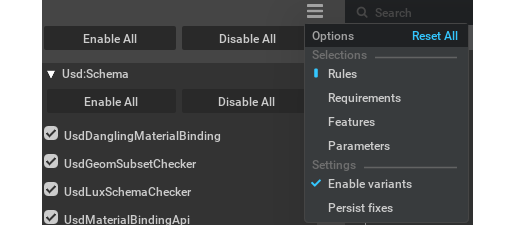
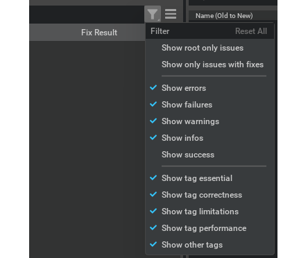

# Options

## Selection options

| Option           | Description                                                                                  |
|------------------|----------------------------------------------------------------------------------------------|
| Rules            | Groups validation checks by categories. Each category contains related validation rules.     |
| Requirements     | Groups validation checks by capabilities. Select individual requirements to validate.        |
| Features         | Groups validation checks by features. Each feature bundles related requirements together.    |
| Parameters       | View and modify validation parameters used by rules and requirements.                        |
| Enable variants  | When enabled, the validator processes all variant combinations in the USD stage.             |
| Persist fixes    | When enabled, fixes are automatically saved to disk after being applied.                     |

## Results filters

| Filter                      | Default | Description                                                        |
|-----------------------------|---------|-------------------------------------------------------------------|
| Show root only issues       | Off     | Filter to only show issues on the root layer.                     |
| Show only issues with fixes | Off     | Filter to only show issues that have fix suggestions.             |
| Show errors                 | On      | Show issues that caused errors during validation.                 |
| Show failures               | On      | Show issues that failed validation checks.                        |
| Show warnings               | On      | Show warning-level issues.                                        |
| Show infos                  | On      | Show informational messages.                                      |
| Show success                | Off     | Show successful validation results.                               |
| Show tag essential          | On      | Show issues tagged as essential.                                  |
| Show tag correctness        | On      | Show issues tagged for correctness.                               |
| Show tag limitations        | On      | Show issues tagged for limitations.                               |
| Show tag performance        | On      | Show performance-related issues.                                  |
| Show other tags             | On      | Show issues with other tags.                                      |
