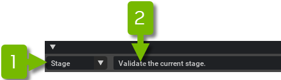

# Validation

## Choosing the Asset Mode

The _Asset Validator Window_ operates in three different contexts called **Asset Modes**:

- **URI Mode** operates on an Omniverse URI, including files and folders on your local disk, networked drives,
  or any other protocol supported by Omniverse (i.e. https).
- **Stage Mode** operates on the currently loaded stage in memory within the application.
- **Prim mode** operates on a set of prims of the current Stage.

Switch between these modes using the dropdown menu at the top left corner. The asset and rule selections will be
preserved when modes are switched.

By default the window opens in **Stage Mode** (1), which is preset to validate the default/current stage of the
application (2):



```{eval-rst}
.. caution::
    Using **Stage Mode** runs on the current composed stage.
```

**URI Mode** (1):


To locate an Asset URI, use the _Asset URI Browser Button_ (2) or paste a link into the _Asset Description_ (3).
In this mode, the description must be the fully qualified URI of the Asset
(i.e. ``omniverse://localhost/NVIDIA/Samples/Astronaut/Astronaut.usd``).

**Prim mode** (1):


The search field would allow you to remove paths, or search for paths. Paths can also be selected from the
stage window.

## Enabling and Disabling


Rules or requirements can be enabled or disabled individually by using the checkboxes (1), or by clicking
``Enable All/Disable All`` Buttons (2) to do this for all rules or per category filtering.

```{eval-rst}
.. tip::
    Tooltips will explain the logic behind each rule.
        .. image:: ../data/docs/asset-validator-ruleDescription.png
```

## Running the Validator

Click the **Analyze Asset Validation** button at the bottom of the window to run the enabled validation rules (1):


```{eval-rst}
.. caution::
    There may be a brief pause while the system contacts the appropriate server for URI Mode, particularly if
    the file or folder hasn't been accessed previously.
```

The _Asset Validator Window_ will now advance to an in-progress results listing of individual assets. This may
initially be a blank page, but as each asset is located by the Omni Client Library, a new loading bar will appear:


```{eval-rst}
.. tip::
    These sections are expandable to show more details about results.
        .. image:: ../data/docs/asset-validator-waiting-details.png
```

## Reviewing Results

When validation completes, the relevant section will update to one of the following statuses:

- **Valid**: Assets that pass all rules without issue will be blue with a checkmark icon.
- **Failure**: Assets that failed or errored on _any_ of the validation rules will be marked in red.
- **Warning**: Assets that generated no failures may have still generated warnings and will be marked in yellow.
- **Error**: This indicates there is an uncaught exception when exploring the asset.

Hovering on the section header will provide a quick summary total (1):


Click through the section headers for detailed reports of each issue (1). There may be *many* issues, as some
rules run per prim and per-variant:


### Copying/Saving Issues

Select the issues or assets and right click on them to copy the issues with the (1) `Copy Selected Issue Items`
button. This will put in your clipboard the contents of the selected issues in a human-readable format. The
selected issues can be saved by selecting (2) `Save Selected Issue Items` to a .csv file.


### Fixing Issues

Issues that have fix suggestions can make use of `Fix Selected`. Select issues that need fixing and use
`Fix Selected` to perform the fix. Saving the changes will apply the fixes to the current stage or targeted files.


The `Save fixes` option allows files to be auto saved when fixes are applied. This can be useful for reference
layers or when dealing with multiple issues and/or files.


Some issues may have multiple locations to fix (1). Asset validation offers a default option, but one can be
specified if applicable.


Clicking on the ``Suggestion`` (in the example above ``Compute the extents``) will fix a single issue. The fix
will persist if the option ``Save fixes`` is enabled.

```{eval-rst}
.. note::
    Repeated validation of the same asset will be substantially quicker. Any interaction with servers should
    be cached and the stage itself may still be in-memory.
```
