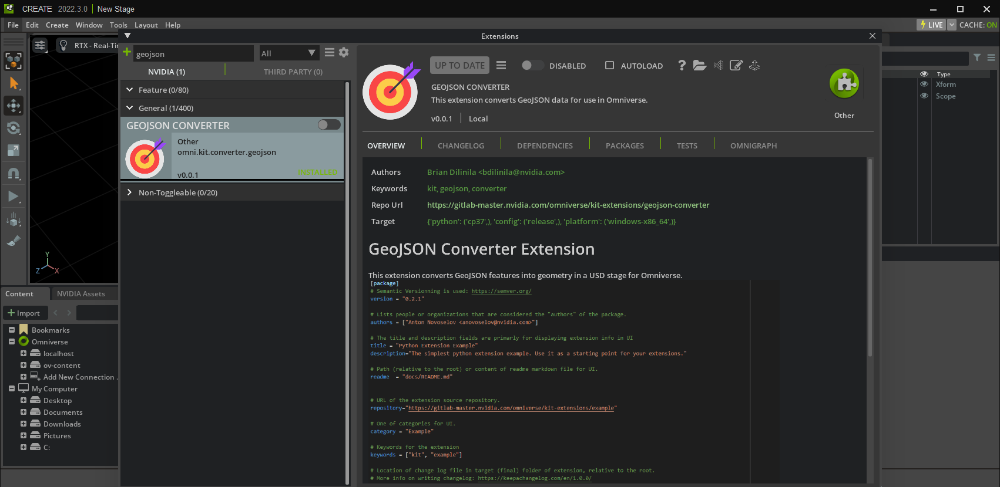
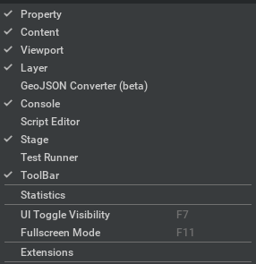
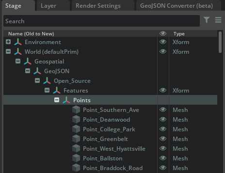
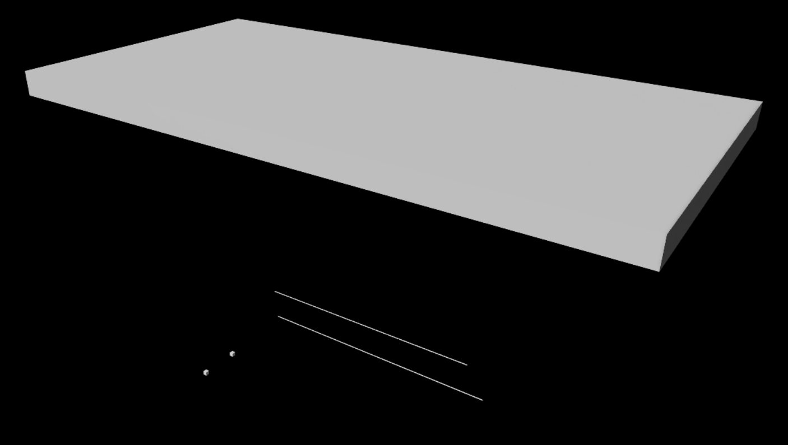

# GeoJSON Converter

## Overview

The NVIDIA Omniverse™ GeoJSON Converter Extension parses geospatial data stored in GeoJSON files and visualizes them in Omniverse™.

## Features

- Parses GeoJSON (.geojson) files and converts the data into prims on a USD stage.
- Supports conversion of Point, MultiPoint, LineString, MultiLineString, Polygon, and MultiPolygon GeoJSON feature geometry types.
- UI window provides a field for the user to define a file location containing the GeoJSON file(s) and a checkbox to toggle recursive checking for GeoJSON files from a user-defined file location.

> **Note**: The tool is currently able to convert data following the WGS84 coordinate system.

## Parsing and Converting GeoJSON Data

This tutorial provides the steps to generate map tiles as meshes in Omniverse Composer. The *OGC Map Tile Loader* Extension is not enabled by default in Omniverse Composer and will need to be enabled for use.

1. Open Omniverse Composer.

   

2. Navigate to **Window > Extensions**.

   

3. Search for and enable the GeoJSON Converter Extension.

   

4. Navigate to **Window > GeoJSON Converter (beta)** to open the extension window.

   

5. Click on the **GeoJSON Converter (Beta)** tab.

   

The window contains a collapsible section for settings. Below is a description of each field:

| Fields                               | Description                                                                 |
|--------------------------------------|-----------------------------------------------------------------------------|
| **File location(s)**                 | (string) Starting directory path containing GeoJSON file(s).                |
| **Recursively check for GeoJSON files?** | (checkbox) Recursively check for GeoJSON files starting from this directory, or parse only the files at the defined directory. |

6. In the **Settings** collapsible section, add the absolute path for the folder you wish to parse GeoJSON data from in the **File location(s)** field.

   

   > **Note**: Providing a relative path will cause errors. Some paths may be invalid due to user read-write permissions or the folder's existence.

7. Select or deselect the **Recursively check for GeoJSON files?** checkbox to enable or disable recursive traversal starting from the defined directory.

8. When ready, click on the **Convert GeoJSON File(s)** button.

   > **Note**: The conversion process may take some time to complete.

9. Verify the created features in the stage by navigating to the **Stage** tab, selecting the Geospatial prim, and pressing the `F` key to focus on the desired feature.

   

   

   > **Note**: If you cannot see the feature, try zooming in and out. For better rendering, follow these optional steps:

10. (Optional) In the viewport, select the **Perspective** camera and click the three-slider icon to the right of Perspective.

    

11. (Optional) In the **Properties** tab, increase the far clipping range value by multiplying the current value (e.g., "100000000.0" becomes "1000000000.0").

    

12. (Optional) If your GeoJSON file contains features with a "properties" object, the GeoJSON Converter will convert each entry into a USD attribute for the corresponding USD feature. The supported GeoJSON property types are:

| GeoJSON Type | Matching USD Type in C++ and Python                 |
|--------------|-----------------------------------------------------|
| **boolean**  | `PXR_NS::SdfValueTypeNames->Bool` (saved as bool)      |
| **number**   | `PXR_NS::SdfValueTypeNames->Double` (saved as double) |
| **string**   | `PXR_NS::SdfValueTypeNames->String` (saved as string) |

The namespace of each attribute starts with `omni:kit:converter:ogc`, followed by `:property_name`. Here is an example of accessing attributes in C++:

```cpp
bool readBool;
PXR_NS::UsdAttribute readBoolAttr = my_prim.GetAttribute(PXR_NS::TfToken("omni:kit:converter:geojson:my_boolean_attribute"));
readBoolAttr.Get(&readBool);

double readNumber;
PXR_NS::UsdAttribute readNumberAttr = my_prim.GetAttribute(PXR_NS::TfToken("omni:kit:converter:ogc:my_number_attribute"));
readNumberAttr.Get(&readNumber);

std::string readString;
PXR_NS::UsdAttribute readStringAttr = my_prim.GetAttribute(PXR_NS::TfToken("omni:kit:converter:geojson:my_string_attribute"));
readStringAttr.Get(&readString);
```

You can also view how to get the value of an attribute in Python from the [Omniverse documentation](https://docs.omniverse.nvidia.com/dev-guide/latest/programmer_ref/usd/properties/get-attribute-value.html).

## Release Notes

### 0.0.8

- Store String/Number (as doubles)/Boolean properties as USD attributes.
- Precision fix to store GeoJSON values as doubles where possible (with exceptions for USD basis curve and mesh points).
- Changed conversion from degrees-to-meters instead of the stage’s `metersPerUnit` (0.01).
- `BasisCurves` now set to linear.
- Additional `Xform` added between GeoJSON and Features for better grouping and origin movement.
- "Features" `Xform` set to the first coordinate of the first GeoJSON geometry.

### 0.0.7

- Updates to packages for Kit 105, USD 22.11, Python 3.10.

### 0.0.5

- Added title bar for undocked window.

### 0.0.3

- Beta release for Create 2022.3.
- Added GeoJSON features: Point, MultiPoint, MultiLineString.

### 0.0.1

- Initial beta build.

## Known Issues

### Rendering Issues

- When prims are placed far from the origin, gaps may appear between them. Select the prim set under the "Features" Xform and set its translation to `{0,0,0}` to address this issue.
