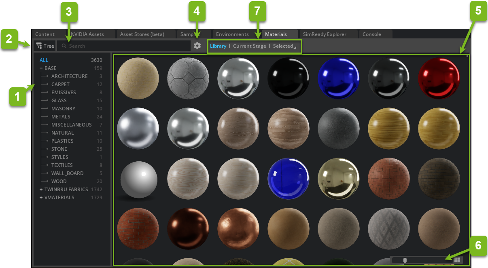
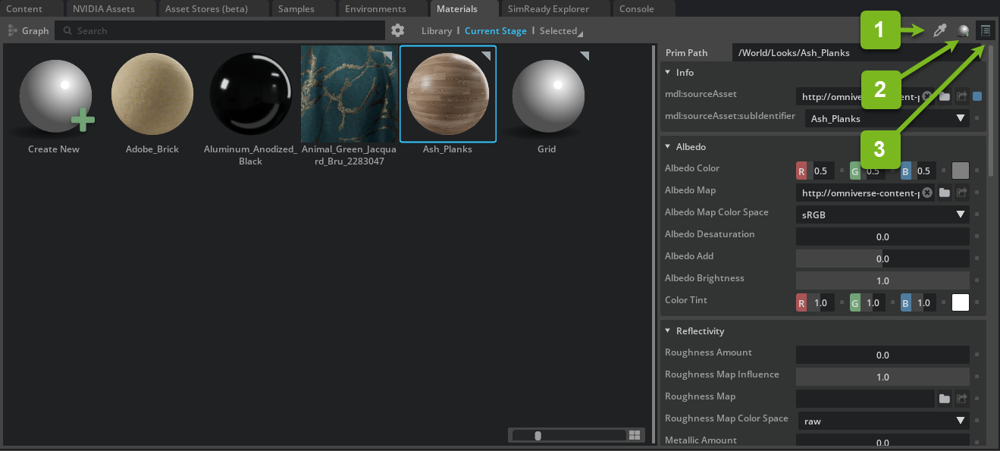
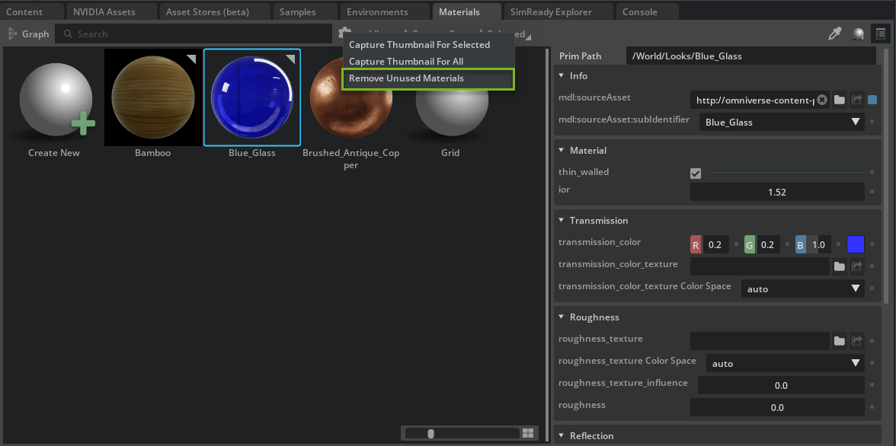

# Material Browser

The Material Browser extension displays high quality MDL materials. You can organize existing materials, create new ones, and easily apply materials to Prims on the Stage via drag and drop.

## Interface

| Ref # | Name | Description |
|-------|------|-------------|
| 1 | Collection Selector | Allows selection of a specified collection. |
| 2 | Category List | Displays a list of categories found within the collections. |
| 3 | Show/Hide Category List | Toggles the Category list on and off. |
| 4 | Search | Searches the current collection for the terms provided. |
| 5 | Options | **Add Collection:** Browse to select a material folder to be used as a collection. **Remove Collection:** Removes the currently selected collection in the collection selector. **Generate Thumbnails** (Selected/All/Library): Orders creation of thumbnails at the specified level. **Remove Unused Materials:** In Current Scene Browser Mode, removes any Materials not being used. |
| 6 | Help | Opens Omniverse documentation. |
| 7 | Material List | Displays all materials in the selected category. |
| 8 | Thumbnail Size | Slider scales the thumbnails listed in the Material List. |
| 9 | Browser Mode | Toggle the Search Mode between Library, Current Scene and Selected Asset. **Library:** Displays Materials from Defined Libraries. **Current Scene:** Displays all materials in current open scene. **Selected:** Displays materials on current selections. |

> **Note:** Collections may be organized using sub-folders. These sub-folders act to create the category list.

## Applying Materials

### Drag and Drop

Click and hold on any material in the Material Browser and drag it over a mesh in the viewport or on the stage, then release. The material will be applied.

### Right Click

In the Material Browser, select one or multiple meshes, then right-click on a material and select **Create on Selected** to apply the material to one or many meshes.

## Current Stage and Selected Browser Modes

The **Current Stage** and **Selected** browser modes contain additional buttons for working with materials.

| Ref # | Name | Description |
|-------|------|-------------|
| 1 | Material Sampler | Allows you to easily view the material of any Prim on the stage. Click this button and then click on the desired Prim to reveal the material in the Browser. |
| 2 | Create New Material | Creates a new Material. |
| 3 | Material Parameters | Toggles the Material Properties window for the currently selected material. |

## Cleaning Up the Current Stage View

The **Current Stage** browser view is useful for seeing what materials are in use in your Stage. If you delete a Prim, you need to manually update this view to reflect those changes.

1. Click the **Options** button.
2. Select the **Remove Unused Materials** option to clean up the view.

