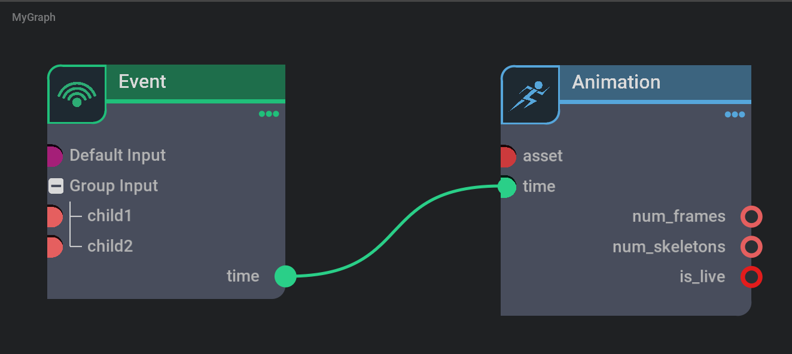
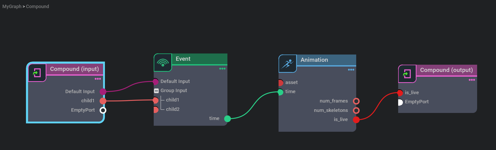
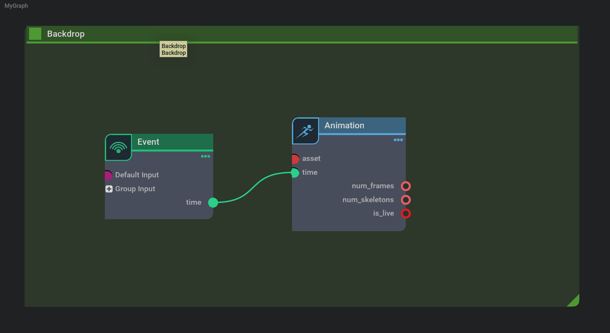

# Graph Model

The graph model is the central component of the graph widget. It is the application's dynamic data structure, independent of the user interface. It directly manages the data and closely follows the model-view pattern. It defines the interface to be able to interoperate with the components of the model-view architecture.

## GraphModel

GraphModel is the base class for graph model which provides the standard API. It is not supposed to be instantiated directly. Instead, the user subclasses it to create a new model.

The model manages two kinds of data elements. Nodes and Ports are the atomic data elements of the model.

There is no specific Python type for the elements of the model. Since Python has dynamic types, the model can return any object as a node or a port. When the widget needs to get a property of the node, it provides the given node back to the model, e.g. `model[port].name` in the delegate to query a port's name.

Here is a simple model, defining the nodes and ports which are the key elements for a graph, as well as the properties for the element: connections, name and type:


```python
# define the graph root
graph_root = GraphNode("MyGraph")
# define two nodes with different types under the graph root
nodeA = EventNode("Event", graph_root)
graph_root.add_child(nodeA)
nodeB = AnimationNode("Animation", graph_root)
graph_root.add_child(nodeB)

class MyModel(GraphModel):
    """
    A simple model derived from GraphModel
    """
    @property
    def nodes(self, item=None):
        # when the node is None, we return the graph level node
        if item is None:
            return graph_root

        # when the input item root, we return all the nodes exist on the current graph
        # the return type is a Node list, so the graph nodes are Node type in MyModel
        if item == graph_root:
            return [child for child in graph_root.children()]
        return []

    @property
    def ports(self, item=None):
        # if input is a Node type we return the ports
        if isinstance(item, Node):
            return item.in_ports + item.out_ports
        # if input is a Port type we return the subports of the input port
        elif isinstance(item, Port):
            return item.children
        return []

    @property
    def name(self, item=None):
        # name of the item, item here could either be Node or Port
        return item.name

    @property
    def type(self, item):
        """type of the item, the item here could be Node or Port"""
        return item.type

    @property
    def inputs(self, item):
        # Node type doesn't have connection
        if isinstance(item, Node):
            return None

        # return all the input port's inputs
        if item.is_input:
            return item.inputs

        return None

    @property
    def outputs(self, item):
        # Node type doesn't have connection
        if isinstance(item, Node):
            return None

        # return all the output port's outputs
        if not item.is_input:
            return item.outputs

        return None

    @inputs.setter
    def inputs(self, value, item):
        # disconnection
        if len(value) == 0:
            if isinstance(item, Port):
                if len(item.inputs) > 0:
                    item.inputs.clear()
                elif len(item.outputs)>0:
                    item.outputs.clear()
        else:
            # when the item is not a Port, but a CompoundNode, it means that we are connecting a port to the Output node of
            # a compoundNode. In this case, we need to create a new output port for the node
            source = value[0]
            if isinstance(item, CompoundNode):
                ports = [port.name for port in item.out_ports]
                new_port_name = self.get_next_free_name(item, ports, source.name)
                new_port = Port(new_port_name, source.type, item)
                item.out_ports.append(new_port)
                # We are connecting to the new Port
                new_port.outputs.append(source)
                new_port.node = item
            # if the source is a CompoundNode, then we are connection a port to the Input node of a CompoundNode.
            # we need to create a new input port
            elif isinstance(source, CompoundNode):
                ports = [port.name for port in source.in_ports]
                new_port_name = self.get_next_free_name(source, ports, item.name)
                new_port = Port(new_port_name, item.type, source)
                source.in_ports.append(new_port)
                # add connection
                item.inputs.append(new_port)
                new_port.node = source
            else:
                # do the connection
                if item.is_input:
                    item.inputs.append(source)
                else:
                    item.outputs.append(source)
        self._item_changed(None)


# Accessing nodes and properties example
model = MyModel()

# query the graph
# The graph/node/port is accessed through evaluation of model[key]. It will
# return the proxy object that redirects its properties back to
# model. So the following line will call MyModel.nodes(None).
graph = model[None].nodes
nodes = model[graph].nodes

for node in nodes:
    node_name = model[node].name
    node_type = model[node].type
    print(f"The model has node {node_name} with type {node_type}")

    ports = model[node].ports
    for port in ports:
        # this will call MyModel.name(port)
        port_name = model[port].name
        port_type = model[port].type
        print(f"The node {node_name} has port {port_name} with type {port_type}")

        # prepare data for connection
        if port_name == "output:time":
            source_port = port
        elif port_name == "input:time":
            target_port = port

        subports = model[port].ports
        if subports:
            for subport in subports:
                subport_name = model[subport].name
                subport_type = model[subport].type
                print(f"The port {port_name} has subport {subport_name} with type {subport_type}")

# do the connection
if source_port and target_port:
    model[target_port].inputs = [source_port]

print(f"There is a connection between {target_port.path} and {source_port.path}")
```

Here is the result by running the above script in the script editor:

```
The model has node Event with type Event
The node Event has port input:Default Input with type str
The node Event has port input:Group Input with type group
The port input:Group Input has subport input:child1 with type int
The port input:Group Input has subport input:child2 with type int
The node Event has port output:time with type float
The model has node Animation with type Animation
The node Animation has port input:asset with type asset
The node Animation has port input:time with type float
The node Animation has port output:num_frames with type int
The node Animation has port output:num_skeletons with type int
The node Animation has port output:is_live with type bool

There is a connection between MyGraph:Animation:time and MyGraph:Event:time
```

Here is a visual representation of the graph in the above example.



### Define node and port

The above example is using Node and Port type from `omni.kit.graph.editor.example.nodes`. You can of course define your own type of node and port. For example, you can use Usd.Prim as the node type and Usd.Attribute as the port type (e.g. the node and port in `omni.kit.window.material_graph`) or you can use Sdf.Path for both node and port types.

The return type from the API of `def nodes` defines the node type and `def ports` defines the port type. You can map your own class of nodes and ports to graph's node and port type. A graph can have any number of nodes and a node can have any number of ports. The port can have any number of subports, and further on, subports can have subsubports and so on.

For the above example, `def nodes` will return `MyGraph` GraphNode when input item is `None`, and when the input item is `MyGraph`, it will return a list containing `Event` and `Animation` Nodes. `def ports` will return a list containing `Default Input` and `Group Input` when input item is an `Event` node and return a list containing `child1` and `child2` when input item is `Group Input`.

### Define connections

The property of inputs and outputs define the connections for graphs. At the moment most of our graphs only support connections between one input and one output. The one side connection (two inputs or two outputs) is also available with more details in the future docs. Let's take the common case of one input and one output connection as an example: connect Event node's output time port (source port) with Animation's input time port (destination port).

When we execute the connection using code (`model[target_port].inputs = [source_port]`) or edit the graph to click and drag the source port to connect to the target port, `inputs.setter` is called with the input item as the Animation's input time port and value as a list containing Event node's output time port in this case. The same happens when we right click to disconnect the connection. During the disconnection, the input value will be empty list `[]`


During connection, the first thing we do is to check whether it is a disconnection or connection. Then we execute necessary data changes to cache this connection/disconnection.

How does the delegate know that we should have a connection at a port? The answer is the return value from `inputs` and `outputs`. The `inputs` property returns the input source port for the item port and `outputs` returns the target port for the item port. Take the above connection as an example. Looking at the `MyGraph:Animation:time` port as the input item, `inputs` returns a list containing the Event node's output time port. And there are no outputs for Animation's time port, so `outputs` will return None for Animation's time port. That's enough to describe a connection between two ports. One might want to define `outputs` for `MyGraph:Event:time` as [MyGraph:Animation:time] and None for `inputs`. Keep your graph upstream or downstream through the whole graph to be consistent.

So if we are using upstream connections, we will see most of the time `outputs` will return None. There are exceptions for the subgraph.

## Subgraph and IsolationGraphModel

To create a subgraph node, just drag and drop a subgraph node into the graph (named Scene Graph in the example). When you double click the subgraph node, you enter the subgraph graph editor, you will see that the navigation bar on the top left has updated to your current graph location. More details about navigation in the Graph Core session.




When you want to expose some attributes from the subgraph and connect to nodes outside of the subgraph, firstly, you need to expose the attributes to the subgraph node. You can create Input nodes to expose inputs and Output nodes to expose outputs. The creation of Input and Output nodes is dealt with by IsolationGraphModel. You can create Inputs/Outputs using `add_input_or_output`.

Once Input/Output nodes are created, you can connect the port you want to expose to the EmptyPort of the Input/Output node. During that, `inputs.setter` is called as a normal connection. The only difference is when you connect to EmptyPort, the port doesn't exist on the subgraph node, so we need to create the port first then do the connection. That's the code path of `isinstance(item, CompoundNode)` and `isinstance(source, CompoundNode)` in `inputs.setter`.

Once the attributes are exposed (Default input and child1 from Event as inputs, is_live from Animation as output), you can go back to the MyGraph level by clicking `MyGraph` on the navigation bar. You will see that three ports are created on the Compound node, and then finally, we can connect the exposed port to other nodes, e.g. Debug.is_debug in the above image.

The connection between Animation's is_live and Compound's is_live is reflected as the `outputs` return value for Animation's is_live, since we have no idea about Compound's is_live attribute until that's created by the connection.

## GraphModel with batch position

We created a `GraphModelBatchPositionHelper` class to manage batch position processing. For example, moving a backdrop node, multi-selecting a few nodes and moving them together, or moving the current node's upstream nodes all together, where we need to deal with a collection of positions at the same time.

That's the reason our SimpleGraphModel from the example extension is inherited both from the GraphModel and GraphModelBatchPositionHelper. GraphModel defines the basic graph data structure and GraphModelBatchPositionHelper allows us to deal with batch position processing much more easily.

### Backdrop



A Backdrop is used to group nodes together to make the graph more organized. Different from subgraphs, it lives on the same level of the nodes placed in the given backdrop. A Backdrop just gives a visual UI group to the nodes. When we move the backdrop, the nodes which are placed in the given backdrop will move together. We leverage GraphModelBatchPositionHelper to do that.

BackdropGetter is defined in `omni.kit.widget.graph` as a helper to get the nodes that are placed in the given backdrop. `BackdropGetter(self, lambda item: self[item].type == "Backdrop")` defines the drive item to be the one has the type of "Backdrop" and returns all the nodes which are placed in the drive item.

We add the function to GraphModelBatchPositionHelper using `self.add_get_moving_items_fn(BackdropGetter(...))` for `batch_position_begin_edit` later to determine which items to move. And `batch_position_end_edit` is used to end the position editing.

### Multi-selection move

This is similar to Backdrop, but the group scheme is using multi-selection instead of Backdrop. `omni.kit.widget.graph` provides a `SelectionGetter` to get all the selected nodes of the given model, corresponding to BackdropGetter.

### Moving Upstream Nodes Together

We provide an example in the `omni.kit.graph.editor.example` such that when you press D and move a node, all the upstreams of the current nodes will move together. This could be useful for organizing your graph faster. It is similar to backdrops and multi-selection, but we need to create a customized `DescendantGetter` ourselves by deriving it from `AbstractBatchPositionGetter`. Again it just returns back all the upstream nodes for the drive node. It acts the same as Backdrop or multi-selection by calling `batch_position_begin_edit` and `batch_position_end_edit`.
