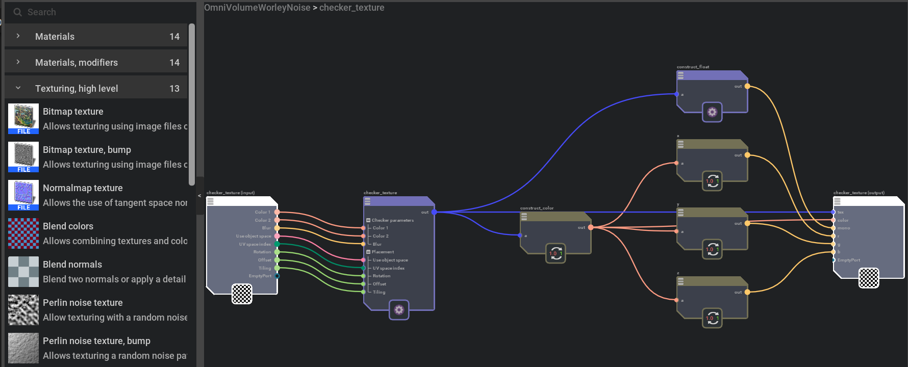
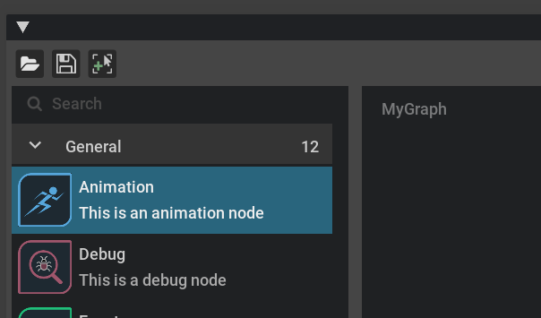

# Graph Core

## Graph View
Following the model-view-delegate pattern, we've introduced the model and delegate. Now we are looking at the `GraphView`. It's the visualisation layer of omni.kit.widget.graph. It behaves like a regular widget and displays nodes and their connections.

Since we mostly just want to use the defined GraphView for all the graphs, we define a core graph widget where you can just focus on building the model and delegate for your customized graph, while reusing the common graph stuff as much as possible.


## Omni.kit.graph.editor.core
We design Omni.kit.graph.editor.core to be the common framework for graph editor in Kit. It is a generic graph widget platform with a standard tree-view panel on the left to show all the available nodes in a list view, with a search bar on the top left. There is the graph editor on the right where we can view and edit the graph. There is also a breadcrumb in the graph view as the navigation of the graph.

We use it as the kit graph core to ensure all standard UI/UX widgets and windows for all our graph nodes are standardized with a common framework.

An example of material graph using omni.kit.graph.editor.core


## Create a graph widget
When you want to create your own graph widget, you can build your GraphWidget (`MyGraphWidget`) based on GraphEditorCoreWidget, define your graph (`self.__graph_model`) and catalog model (`self.__catalog_model`) to manage the graph data, customize graph (`self.__graph_delegate`) and catalog delegate (`self.__catalog_delegate`) look to suit your application.

```execute
##
import omni.ui as ui
from omni.kit.widget.graph import GraphView
from omni.kit.graph.editor.core import GraphEditorCoreWidget
##

class MyGraphWidget(GraphEditorCoreWidget):
    def __init__(self, **kwargs):
        self.__graph_model = None
        self.__graph_delegate = None
        self.__catalog_model = None
        self.__catalog_delegate = None

        toolbar_items = []

        super().__init__(
            model=self.__graph_model,
            delegate=self.__graph_delegate,
            view_type=GraphView,
            style=None,
            catalog_model= self.__catalog_model,
            catalog_delegate= self.__catalog_delegate,
            toolbar_items=toolbar_items,
            has_catalog = True,
            **kwargs,
        )

my_widget = MyGraphWidget()
```

## Navigation
To navigate between different subgraphs, we use `set_current_compound` which changes the current view to show the subgraph of the input item.

## Add right click menu on canvas


To add a right click context menu on the graph canvas, we should call `on_right_mouse_button_pressed` to override the function
in the base class.

Use `ui.Menu` to create the menu and `ui.MenuItem` to add menu items. `ui.Separator()` is useful to create a separator between categories of menus.

An example of `on_right_mouse_button_pressed` is as below:

```execute
def on_right_mouse_button_pressed(self, items):
    self.__context_menu = ui.Menu("Context menu")
    with self.__context_menu:
        ui.MenuItem("Delete Selection", triggered_fn=lambda: self._graph_model.delete_selection())
        ui.Separator()
        ui.MenuItem("Open All", triggered_fn=lambda: self._graph_view.set_expansion(GraphModel.ExpansionState.OPEN))
        ui.MenuItem(
            "Minimize All", triggered_fn=lambda: self._graph_view.set_expansion(GraphModel.ExpansionState.MINIMIZED)
        )
```

## Add button to the ToolBar


To add a toolbar on the top of the graph, one way is to define the `toolbar_items` as the code above before calling GraphEditorCoreWidget's constructor.  `toolbar_items` is a list of dictionaries containing the button name, icon and `on_clicked` callback.

An example of `toolbar_items` is as below:

```python
toolbar_items = [
    { "name": "open", "icon": "open.svg", "on_clicked": open, "tooltip": "Open a graph"},
    {"name": "-"},
    { "name": "save", "icon": "save.svg", "on_clicked": save},
    { "name": "new", "icon": "new.svg", "on_clicked": new},
    ]
```

`{ "name": "open", "icon": "open.svg", "on_clicked": open(), "tooltip": "Open a graph"},` create a button named open with the icon as "open.svg". When you hover over the button, it will show the tooltip of "Open a graph", and when you click on the button, it will call the callable `open` function. `{"name": "-"}` is to create a seperator.

Another way to define the toolbar, is to call `set_toolbar_items` to override the function from `GraphEditorCoreWidget`. This is useful if you want to change the toolbar items when you have already created your `GraphEditorCoreWidget`. The input attribute is the same type as the above example.
