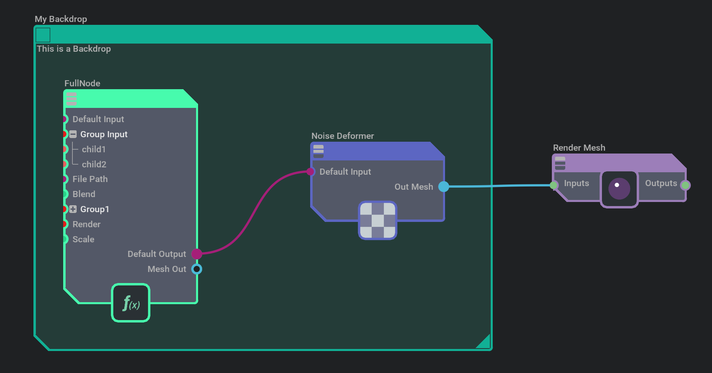
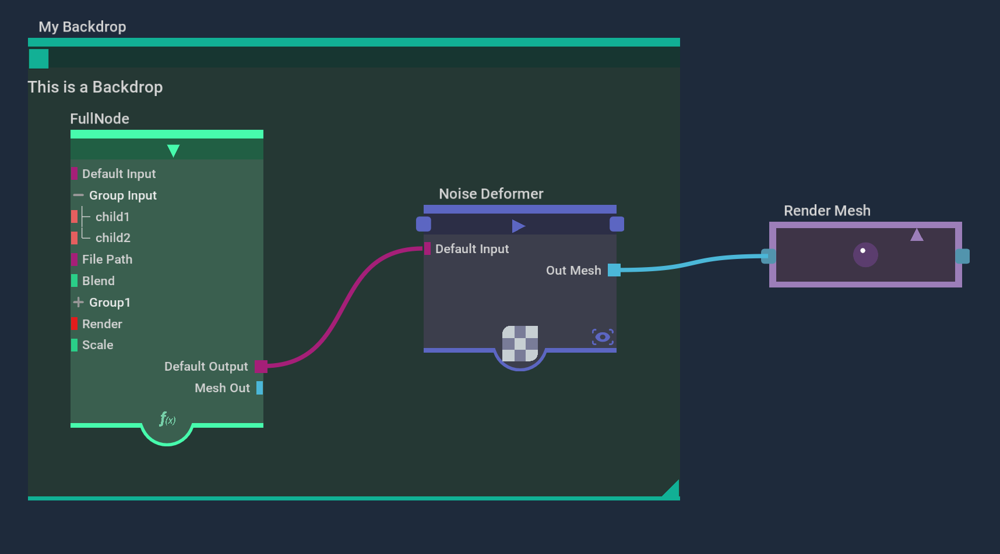
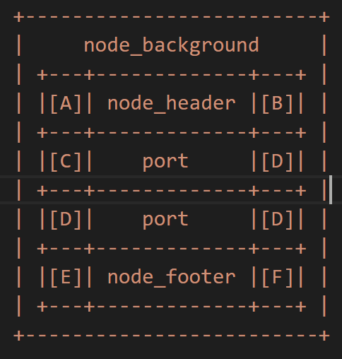
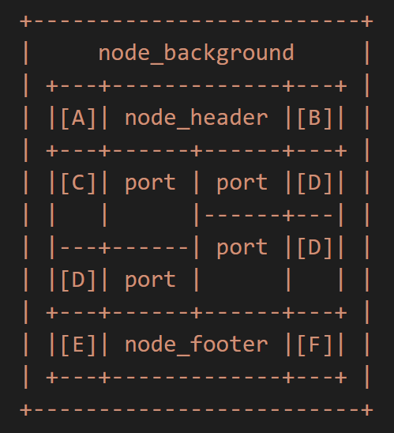

# Graph Delegate
Graph delegate describes how the graph looks, including the nodes, ports, connections and the editor itself. We have three different delegates available at the moment: omni.kit.delegate.default, omni.kit.delegate.modern and omni.kit.delegate.neo.

The delegate looks are shown below:

**Modern delegate:**


**Default delegate:**


**Neo delegate:**


The modern delegate will be the new standard look for our tools going forward. But please feel free to modfiy or build your own from any of those examples.

The omni.kit.graph.editor.example provides the example of switching between different delegates from the top right dropdown list. Each delegate is an extension, you can create your customized delegate by forking one of them and starting from there.

## GraphNodeDelegateRouter
From the above images, we can tell that the backdrop node looks quite different from other nodes. Also when the expansion states of nodes are closed (Render Mesh nodes on the right), it also looks very different from when the nodes are open (FullNode on the left) or minimized (Noise Deformer in the middle). Therefore, we need more than one look for the nodes for just one style of delegate. We use `GraphNodeDelegateRouter` to manage that. It is the base class of graph node delegate. It keeps multiple delegates and picks them depending on the routing conditions, e.g. expansion state of Closed or Open, node type of backdrop or compound.

We use `add_route` to add routing conditions. And the conditions could be a type or a lambda expression. The latest added routing is stronger than previously added. Routing added without conditions is the default delegate. We can use type routing to make the specific kind of nodes unique, and also we can use the lambda function to make the particular state of nodes unique (ex. full/collapsed).

It's possible to use type and lambda routing at the same time. Here are the usage examples:
```python
    delegate.add_route(TextureDelegate(), type="Texture2d")
    delegate.add_route(CollapsedDelegate(), expression=is_collapsed)
```

## Delegate API
Each delegate added to the router is derived from `AbstractGraphNodeDelegate`. The delegate generates widgets that together form the node using the model. The following figure shows the LIST layout of the node.



COLUMNS layout allows for putting input and output ports on the same line:



```python
    [A] node_header_input
    [B] node_header_output
    [C] port_input
    [D] port_output
    [E] node_footer_input (TODO)
    [F] node_footer_output (TODO)
```

For every zone, there is a method that is called to build this zone. For example, `port_input` is the API to be called to create the left part of the port that will be used as input. `node_background` is the API to be called to create widgets of the entire node background.

## Customized Delegate
If you find that `omni.kit.graph.delegate.modern` is the look you like, you want to use it, but there are some special things that don't exist in the delegate, how can you tweak that to create a variant modern look?

We can create a new delegate which is derived from GraphNodeDelegate of omni.kit.graph.delegate.modern. Then you can override the `port_input`, `port_input` or `connection` to obtain a different look for a special type of port and connections. Or you can override the `node_background` or `node_header` to achieve a different style for nodes.

You can potentially override any functions from the delegate class to customize your own delegate. Mix and match delegates from different delegate extensions to create your own. Feel free to fork the code and explore your artistic side to create the delegate that fulfills your needs.

## Add right click action on Nodes/Ports
For example, if I want to use `omni.kit.graph.delegate.modern`, but I need to add a drop down menu to enable some actions when I right click on output ports, how can I do that?

Firstly, we are going to inherit the delegate from the modern extension. Then we can override the `port_output` method from the modern delegate. Create a new frame layer, draw the base class output port within the frame, and add `set_mouse_pressed_fn` callback on the frame to add a right click menu for the output port.

```execute
from omni.kit.graph.delegate.modern.delegate import GraphNodeDelegate
from typing import Any

class MyDelegate(GraphNodeDelegate):
    """
    The delegate for the input/output nodes of the compound.
    """
    def __init__(self):
        super().__init__()

    def __on_menu(self, model, node: Any, port: Any):
        # create menu
        pass

    def port_output(self, model, node_desc, port_desc):
        node = node_desc.node
        port = port_desc.port
        frame = ui.Frame()
        with frame:
            super().port_output(model, node_desc, port_desc)

        frame.set_mouse_pressed_fn(lambda x, y, b, _, m=model, n=node, p=port: b == 1 and self.__on_menu(m, n, p))

```

## Curve Anchors
BezierCurves and Lines have the ability to display a curve anchor, or decoration, that is bound to a specific parametric value on the curve. The widgets that are drawn in the anchor are created in the `anchor_fn` on the FreeBezierCurve or Line. The current parametric (0-1) value where the anchor decoration will be attached is specified with `anchor_position`.

Because there is an interest in attaching some widgets to the curve and drawing them just on top of the curve (a dot, for example), but drawing other widgets, like a floating label decoration, on top of all nodes, the graph drawing is broken up so that connection components can draw into 2 different layers.

### Graph Drawing Layers
The graph is drawn using a ZStack which goes from back to front. It contains these layers:
* **__backdrops_stack** (For backdrops, because they are behind everything.)
* **__connections_under_stack** (All connection curves and anchors directly connected to curves - all above backdrops, but behind nodes.  This layer is always used, regardless of the value of `draw_curve_top_layer`.)
* **__nodes_stack** (all nodes)
* **__connections_over_stack** (Meant for floating anchor decorations that should draw above all nodes.  Curves drawn here should be transparent, so you don't see two copies of them - you only see the floating anchor decoration.  Only used when `draw_curve_top_layer` is True.)

A `connection()` method in the delegate is equipped with a `foreground` arg, like:

```python
def connection(self, model: GraphModel, source: GraphConnectionDescription, target: GraphConnectionDescription, foreground: bool = False)
```

Using the above drawing layer order as a guide, the design is that in the non-`foreground` mode, the connection curve is drawn normally, and any anchor widgets that should be directly on top of the curve should be drawn with the `anchor_fn` (see `draw_anchor_dot` in the code below). These elements will all show up behind nodes in the graph. In the `foreground` pass, the curve should be drawn transparently (using the style) and any floating widgets that should live in front of all nodes should be drawn with a _different_ `anchor_fn` (see `draw_value_display` in the code below). It should be noted that the `foreground=True` pass of `connection()` doesn't run at all unless the GraphView has its `draw_curve_top_layer` arg set to True (it's False by default).

There are 2 things you may have to keep in sync, when using curve anchors in a graph:
1. If you have a FreeBezierCurve representation of a connection when zoomed in, but a FreeLine representation when zoomed out, you will have to make sure any changes to the `anchor_position` in one representation also carry over to the other.
2. If you have both a "dot" anchor widget that is on the curve, as well as a floating decoration, that should stay bound to where the dot is, you need to keep the `anchor_position` for both elements in sync.

Here is some example code from `build_connection` to help with implementing curve anchor decorations:

```python
    ANCHOR_ALIGNMENT = ui.Alignment.CENTER
    ANCHOR_POS = .25
    decoration_label = None

    def drag_anchor(curve, x: float, y: float, button, mod):
        global ANCHOR_POS
        global decoration_label
        if curve:
            t = curve.get_closest_parametric_position(x, y)
            curve.anchor_position = ANCHOR_POS = t
            if decoration_label:
                decoration_label.text = f"Anchor {ANCHOR_POS:.2f}"

    def remove_anchor(curve, x: float, y: float, button, mod):
        async def wait_and_turn_off_anchor_frame():
            await omni.kit.app.get_app().next_update_async()
            curve.set_anchor_fn(None)

        if button == 2:
            asyncio.ensure_future(wait_and_turn_off_anchor_frame())

    def draw_anchor_dot(curve=None):
        global ANCHOR_POS
        global decoration_label
        if curve:
            curve.anchor_position = ANCHOR_POS

        with ui.VStack(style={"margin": 0}):
            with ui.VStack(content_clipping=1, style={"margin_height": 22}):
                dot = ui.Circle(
                    # Make sure this alignment is the same as the anchor_alignment
                    # or this circle won't stick to the curve correctly.
                    alignment=ANCHOR_ALIGNMENT,
                    radius=6,
                    style={"background_color": cl.orange},
                    size_policy=ui.CircleSizePolicy.FIXED,
                )
                dot.set_mouse_pressed_fn(partial(remove_anchor, curve))
                dot.set_mouse_moved_fn(partial(drag_anchor, curve))

    def draw_value_display(curve=None):
        global ANCHOR_POS
        global decoration_label
        if curve:
            curve.anchor_position = ANCHOR_POS

        with ui.VStack(style={"margin": 0}):
            with ui.Placer(stable_size=0, draggable=True, offset_x=0, offset_y=-50):
                with ui.ZStack(content_clipping=1):
                    rect = ui.Rectangle(style={
                        "background_color": 0xFF773322,
                        "border_color": cl.white,
                        "border_width": 2,
                    })
                    decoration_label = ui.Label(f"Anchor {ANCHOR_POS:.2f}",
                                                style={"margin": 8, "color": cl.white})

    if foreground:
        style["color"] = cl.transparent

    curve_container_widget = ui.ZStack()
    with curve_container_widget:
        freeline_widget = ui.FreeLine(
                target.widget,
                source.widget,
                alignment=ui.Alignment.UNDEFINED,
                style=style,
                name=port_type,
                anchor_position=ANCHOR_POS,  # both line and curve will use the same value
                anchor_alignment=ANCHOR_ALIGNMENT,
                visible_max=PORT_VISIBLE_MIN,
                style_type_name_override=override_style_name,
        )
        curve_widget = ui.FreeBezierCurve(
                target.widget,
                source.widget,
                start_tangent_width=ui.Percent(-CONNECTION_CURVE * source_reversed_tangent),
                end_tangent_width=ui.Percent(CONNECTION_CURVE * target_reversed_tangent),
                name=port_type,
                style=style,
                anchor_position=ANCHOR_POS,
                anchor_alignment=ANCHOR_ALIGNMENT,
                visible_min=PORT_VISIBLE_MIN,
                style_type_name_override=override_style_name,
        )
        # Doing this outside the curve creation to be able to pass the curve_widget in as an arg.
        if foreground:
            freeline_widget.set_anchor_fn(partial(draw_value_display, freeline_widget))
            curve_widget.set_anchor_fn(partial(draw_value_display, curve_widget))
        else:
            freeline_widget.set_anchor_fn(partial(draw_anchor_dot, freeline_widget))
            curve_widget.set_anchor_fn(partial(draw_anchor_dot, curve_widget))
            freeline_widget.set_tooltip_fn(tooltip)
            curve_widget.set_tooltip_fn(tooltip)

    return curve_container_widget, freeline_widget, curve_widget
```

This is what that might look like visually:


