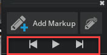
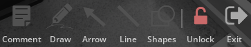
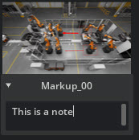
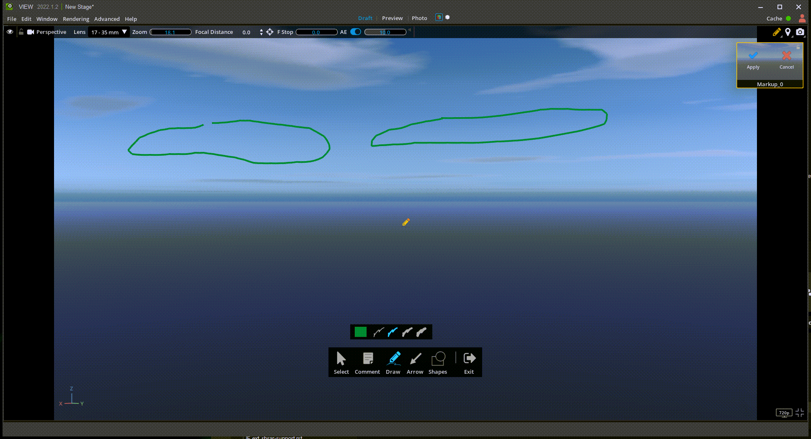
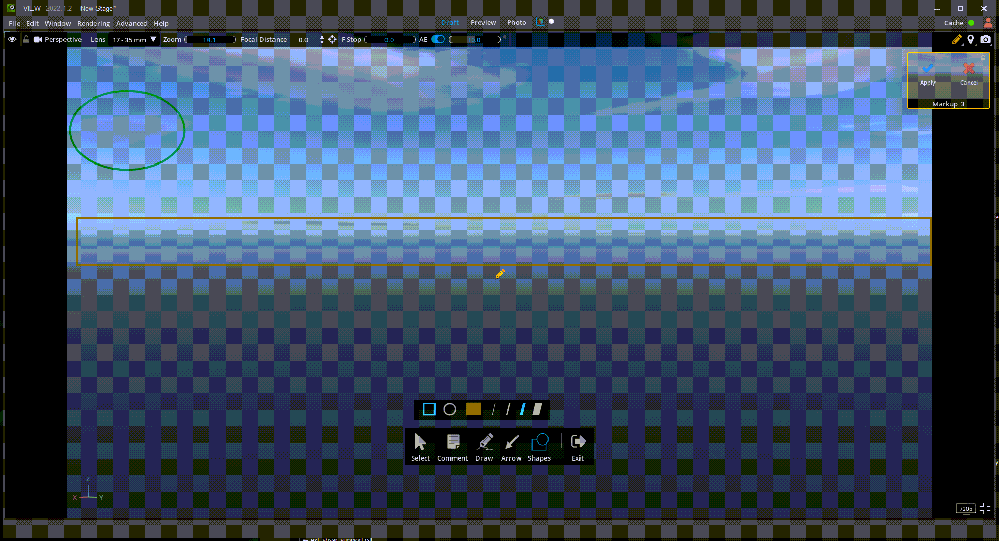
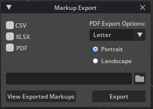

# Markup

The Markup Extension provides the ability to annotate a 3D scene with a 2D whiteboard overlay from any location in a USD Stage.

> **Note:** Users can view Markups together or create Markups within the same Live Session. However only 1 user can edit a specific Markup at a given time.

## Using Markup

To access the Markup tool, click the Markup button in one of the access points, depending on which application is being used.

1. The Markup Filmstrip can be toggled on and off from the Viewport controls at the top of the screen.
2. The Markup Filmstrip can also be toggled on and off from the navigation bar in Viewport experiences such as Review mode in USD Explorer.

## Markup Filmstrip

| Menu Item | Description |
|---|---|
| Add Markup button | Adds a new Markup at the current location and view |
| Export Markup | Opens Export Dialog for Exporting Markup to an external file |
| Markup playlist controls | Play through Markups at 5 second intervals or advance between Markups |
| Markup | View and Edit saved Markups |
| Markup name | Right click to Rename Markup |
| Notes | Enter notes for selected Markup |

## Create Markup

1. Position and orient your stage view to the desired shot.
2. `Left-click` either **Markup Button** to open the Markup Filmstrip.
3. `Left-click` the **Add Markup Button** at the top of the panel.

> **Note:** When a Markup is being edited, the screen is locked and the view cannot be moved. The Markup must be applied or canceled to return to moving in 3d space.

## Navigate with Markup

You can navigate through the Markup multiple ways.

- `Left-click` on the existing Markup gizmos in the viewport to navigate to them.

Markup can also be navigated in the Markup Filmstrip panel.
- Click on any Markup in the Markup Filmstrip to go directly to it.

## Edit and Delete Markup

When viewing Markups, the Markup sub-tools will be disabled. To edit the Markup, click on the unlock icon either on the Markup tool bar or from the Markup hover state on the Markup Filmstrip.

- To edit a Markup, hover over it and press the unlock icon. This allows you to reposition your view and then recapture the Markup. When A Markup is being edited, there will be a yellow outline around the Markup in the Markup Filmstrip.

### Markup Playlist Controls

1. Use Previous and next arrows to advance between Markups.
2. Use the play button to flip through your Markups like a slideshow at 5 second intervals.

### Markup Name

- Right click to Rename Markup.

### Markup Notes

- To add a note to a Markup, press the drop-down arrow below it to reveal a text field.

## Markup Sub-tools

| Ref # | Option | Usage |
|---|---|---|
| 3 | Comment | Place a text box annotation on the stage |
| 4 | Draw | Draw lines or squiggles |
| 5 | Arrow | Draw single or double-sided arrows |
| 6 | Shapes | Draw circles or squares |
| 7 | Exit | Exit markup editor NOTE: Click *Apply* to save your work |

Markups can have multiple elements drawn from all listed sub-tools combined. Common commands for Markup sub-tools include the following.

- **Selection** - To select a Markup Element, simply hover over a part of it and click. A transform box will appear of that element. Only one element can be selected at a time.
- **Transform** - A selected Markup Element can be transformed by grabbing the handle at the top of the bounding box or by grabbing and moving any transform anchor point.
- **Edit** - When a MarkUp element is selected, it has a property strip attached to it. These allow the current element to be edited or deleted.
- **Apply / Cancel** - All Markups must be applied or canceled to exit Markup edit context.

### Comment

The Comment sub-tool provides a basic text annotation and editing sub-tool and provides four text font sizes, and a color picker. Click "Apply" to save.

### Draw

The Draw sub-tool allows freehand lines to be drawn on the stage and provides four line thicknesses. When drawing, a box will expand around the drawing across the screen showing the total area of the drawing as it is painted. Click "Apply" to save.

### Arrow

The Arrow sub-tool allows single or double ended arrows to be drawn. The left-most arrow will draw the arrow from tip to tail (based on start/end point); the middle arrow selection will draw from tail to tip, and the double arrow may be started at either origin or endpoint. Click "Apply" to save.

### Shapes

The Shapes sub-tool allows you to draw a square or circle of any size, and provides four line sizes. Click "Apply" to save.

### Apply/Cancel

When a given Markup is finished editing, click "Apply" to save to the Markup Manager window, or "Cancel" to abandon the operation without saving.

## Export Markup

Markup can be exported to a variety of common formats so that annotations can be shared externally from Omniverse.

To Export Markup:

1. Open the Markup Filmstrip
2. On the top right, press the Export Markup button
3. Set output options
4. Press Export

To view exported Markups, press **View Exported Markups** on the Markup Export Dialog. This will open the folder where this file was exported on your PC.

### Export Options

Markups can be exported in the following formats

- PDF - The PDF option has more options for size (Letter or A4) and orientation (Portrait or Landscape).
- CSV
- XLSX

## Markup Preferences

Markup Viewport control can be repositioned in the Application Preferences, Viewport section.

