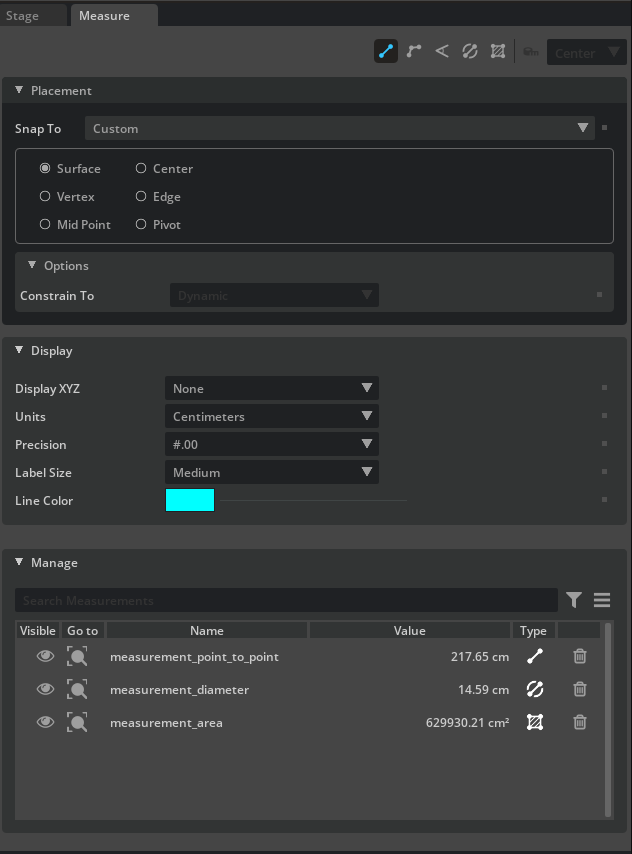
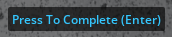
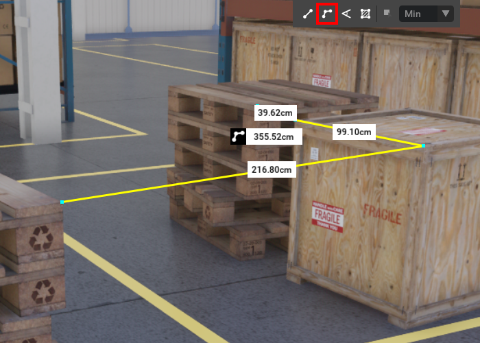
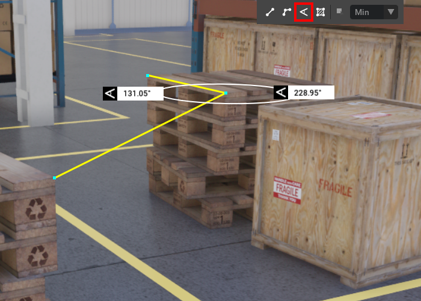
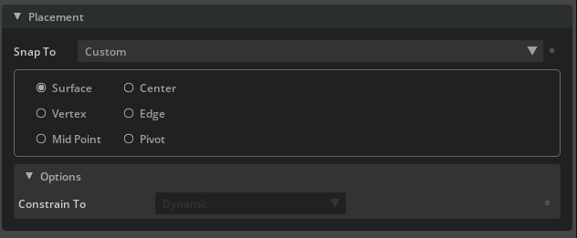
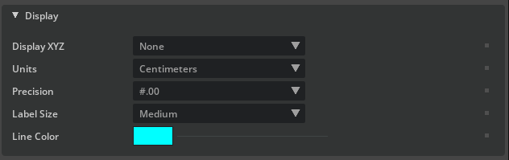

# Measure Tool

The Measure Tool Extension can be used to query for distances between objects with a variety of options. It is also possible to determine staggered distances, angles and areas.

    

    

    

    

    
    
    

> **Note:** The Measure Tool supports Live Collaboration. When you make measurements in a Live Collaboration Session, they are replicated to other users.

## Using Measure

Measure can be called in Applications from the main menu under **Tools > Measure**.

It can also be called in USD Explorer from the Navigation bar located at the bottom of the viewport.

Measure is built up of a series measurement sub-tools. The main interface panel controls options for each sub-tool.

> **Note:** The Placement area is only visible when one of the sub-tools is selected.

| Option | Result |
|:---|:---|
| Sub-tool Selector | This area holds the following sub-tools: **Measure Selected**, **Point-to-point**, **Multi-point**, **Angle**, and **Area** |
| Placement | This group holds options to aid in making measurements within the viewport. Some fields are tool-specific. See Placement Parameters for more information. |
| Display | This panel holds options for the measurement during and after the measurement is created. See Display Parameters for more information. |
| Manage | This group lists all the measurements in the scene along with their visibility, name, value, and measurement type. |

## Measure Sub Tools

Sub-tools allow for the creation and viewing of a measurement based on the tool's context.

1. Point To Point - Measure a distance with 2 points.
2. Multi Point - Strings together multiple Point to Points dimensions, sharing anchor points.
3. Angle - Measure the angle between two surfaces.
4. Diameter - Measure the diameter of circular shapes.
5. Area - Measure the area on a flat plane.
6. Measure Selected - Measure a point to point distance between two selected objects.

Some common commands for all measurement types are as follows:

- Left Click always is for creating new anchor points.
- Completing a measurement is automatic for measurements that have a specific number of anchor points like Point to Point or Angle.
- Completing a measurement with an arbitrary number of anchor points: press Enter, Right Click, or simply press the Complete Button on screen.
- A measurement can be canceled at anytime during creation by pressing Escape.
- A measurement can be deleted by selecting it in the viewport and pressing delete or by using the Manager section of the Measure Tool.

### Point-to-point

1. Enable `Point-to-Point` by pressing the **Point-to-Point** toolbar button in the Measure Panel.
2. Adjust the placement and display options for making the selection of the first point in the viewport.
3. Left-Click in the viewport to make the first point of the measurement.
4. Left-Click a second time in the viewport to make the end point of the measurement.

### Multi-point

1. Enable `Multi Point` by pressing the **Multi Point** toolbar button in the Measure Panel.
2. Adjust the placement and display options for making the selection of the first point in the viewport.
3. Left-Click in the viewport to make the first point of the measurement.
4. Append points for each additional Left-Click in the viewport.
5. To end a `Multi Point` measurement, Right click, press Enter, or press the Complete measurement button on screen.

### Angle

1. Enable `Angle` by pressing the **Angle** toolbar button in the Measure Panel.
2. Adjust the placement and display options for making the selection of the first point in the viewport.
3. Left-Click in the viewport to make the first point of the measurement.
4. Left-Click a second time in the viewport to make the mid point of the measurement.
5. To end an `Angle` measurement, Right click, press Enter, or press the Complete measurement button on screen.

### Diameter

1. Enable `Angle` by pressing the **Angle** toolbar button in the Measure Panel.
2. Adjust the placement and display options for making the selection of the first point in the viewport.
3. Left-Click in the viewport to make the first point of the measurement.
4. Left-Click a second time in the viewport to make the mid point of the measurement.
5. To end an `Angle` measurement, Right click, press Enter, or press the Complete measurement button on screen.

### Area

1. Enable `Area` by pressing the **Area** toolbar button in the Measure Panel.
2. Adjust the placement and display options for making the selection of the first point in the viewport.
3. Left-Click in the viewport to make the first point of the measurement.
4. Append points for each additional Left-Click in the viewport. Three points are required to calculate the area.
5. Right click in the viewport to finalize the measurement.
6. Right click to clear the final measurement and start over.

> **Note:** Use the Constrain to property to align points along a specific axis plane. Default aligns to the Scene Up of the stage.

### Measure Selected

Measure Selected measures a point to point distance between two objects. The dimension can be from the minimum distance, maximum distance, or center of both objects.

1. Select 2 prims in the scene. This is **required** in order to enable the tool activation.
2. Adjust the **Selected Mode** and display options as required for your measuring operation in the Measure panel.
3. Press the **Selected** toolbar button in the Measure panel.
4. A measurement is then established denoting distance in the viewport.

## Placement Parameters

The Placement panel is the single source of control for placing points in the viewport to create a measurement. Only 1 snap is available at a given time.

| Option | Result |
|:---|:---|
| Snap To | Provides the option to select from custom snapping for Perpendicular (Point-to-point sub-tool only) |
| Snap: Pivot | Snaps the point to the first raycast-hit object pivot. |
| Snap: Center | Snaps to the center bound point of the first raycast-hit object. May inherit parent xform center if no transform exists. |
| Snap: Vertex | Snaps the point to the first raycast-hit surface vertex. |
| Snap: Mid Point | Snaps the point to the first raycast-hit edge midpoint. |
| Snap: Edge | Snaps the point to the first raycast-hit edge. |
| Options: Constrain To | Area sub-tool only. Constrains measurement to a plane based on the selected axis. |

## Display Parameters

The display panel handles configuration options for measurements being created.

| Option | Result |
|:---|:---|
| Display XYZ | Allows for the ability to display World or Local (based on first selection) XYZ dimensions. |
| Units | Controls the display of measurements in common units (centimeter, inch, millimeter, etc.) |
| Precision | The number decimal places to use before rounding. |
| Label Size | The font size of the generated labels for the measurement. |
| Line Color | Defines the main color of the created measurement. |

> **Note:** The line color must be specified before the first measurement selection.

## Manager

The Manager group allows a user to list out all the measurements in a scene.

The Measure Tool Manager can be searched and filtered.

| Option | Result |
|:---|:---|
| Visible | Controls the visibility of each measurement in the viewport. |
| Go To | Pressing this button frames the measurement in the viewport. |
| Name | The name of the measurements. Double click the name to edit the name of a measurement. |
| Value | The current value of the measurement. |
| Type | Reflects the type of measurement. |
| Delete | Pressing this deletes the associated measurement. |

### Measure Export

Measurements can be exported to a .csv file to be used externally.

To export a measurement, do the following:

1. Open Measure Tool.
2. On the Measurement manager section, click on the options button in the upper right.
3. Select Export to CSV.
4. Choose your file path and press Export.
