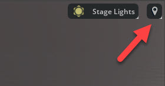
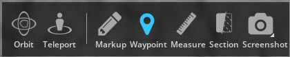
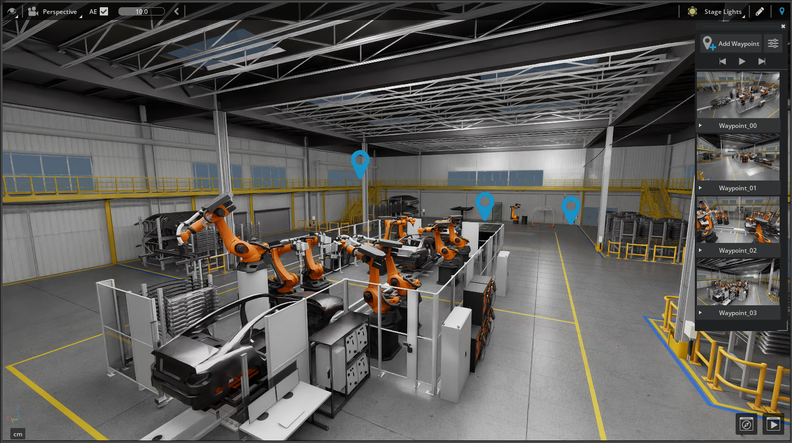
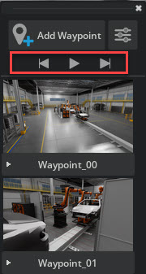
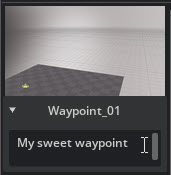
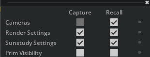

# Waypoint

The Waypoint Extension allows you to create location markers called Waypoints. These markers represent a camera view and you can create/save them in your USD Stage. You can use Waypoints at any time to easily navigate back to a particular camera view. This Extension is enabled by default in most Omniverse Apps, like USD Explorer and USD Composer.

> **Note:** This Extension supports Live Collaboration. You can create and view Waypoints with other users.

## Using Waypoints

The Waypoint Filmstrip is where Waypoints can be created, viewed, and managed. There are two ways to display the Waypoint Filmstrip:

1. The **Waypoint button**, which is defaulted to the top right of the Viewport control bar.

2. The **Waypoint button** located in the Navigation Bar. This access point is available for viewport experiences such as Review mode in USD Explorer.

## Waypoint Filmstrip

The **Waypoint Filmstrip** is a floating viewport window that allows you to manage your Waypoints.

| Ref # | Menu Item | Description |
|---|---|---|
| 1 | Add Waypoint button | Adds a new Waypoint. |
| 2 | Waypoint settings button | Opens the Waypoint settings window. |
| 3 | Waypoint playlist controls | Play through Waypoints at 5 second intervals or advance between Waypoints. |
| 4 | Waypoint | Click on this to navigate to a Waypoint. This Waypoint can be edited or deleted by accessing the on hover controls for each Waypoint. |
| 5 | Notes | Click on this to edits notes associated with this Waypoint. |

## Create a Waypoint

1. Position and orient your Stage view to the desired shot.
2. Left-click either **Waypoint Control** to open the Waypoint Filmstrip.
3. Left-click the **Add Waypoint** button at the top of the panel.

## Navigate through Waypoints

You can navigate through the Waypoints multiple ways.

- Left-click on the existing Waypoint gizmos in the viewport to navigate to them.

Waypoints can also be navigated in the Waypoint Filmstrip panel.

- Click on **any Waypoint** in the Waypoint Film strip to go directly to it.

### Waypoint Playlist Controls

1. Use Previous and next arrows to advance between Waypoints.
2. Use the play button to flip through your Waypoints like a slideshow.

### Name/Rename a Waypoint

- Right click to Rename Waypoint.

### Add note to a Waypoint

- To add a note to a Waypoint, press the **drop-down arrow** below it to reveal a text field.

### Edit or Delete a Waypoint

- To edit a Waypoint hover over the Waypoint and press the unlock icon. This allows you to reposition your view and then recapture the Waypoint. When a Waypoint is being edited, there will be a yellow outline around the Waypoint in the Waypoint Filmstrip.

## Access a Waypoint's settings

Waypoints store more than the location and orientation of a camera view. Waypoints can store various information about the scene that can be recalled later.

- To open the window, click on the **Waypoint Settings button** on the top of the Waypoint Filmstrip panel.

| Ref # | Menu Item | Description |
|---|---|---|
| 1 | Capture | Use the checkboxes in this column to denote what data gets stored in a Waypoint |
| 2 | Recall | Use the checkboxes in this column to denote what data is viewed in a Waypoint |

## Waypoint Preferences

Waypoint Viewport control can be repositioned in the Application Preferences, Viewport section.

