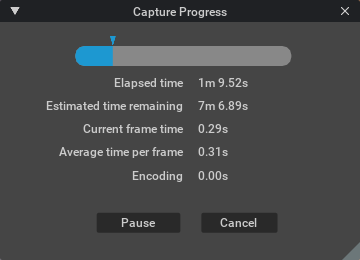

```{csv-table}
**Extension**: {{ extension_version }},**Documentation Generated**: {sub-ref}`today`
```

# Overview

The Movie Capture extension provides a dedicated interface for capturing the viewport, either as a single frame or as a sequence. It is designed to offer a complete, ready-to-use solution for users who need to quickly capture high-quality images or video directly from the viewport. The extension integrates several capture settings and UI panels for adjusting camera, render, output, and farm options to streamline the capturing process.

```{image} ../../../../source/extensions/ui/omni.kit.window.movie_capture/data/preview.png
---
align: center
---
```


## User Guide

### Movie Capture Interface


| UI Element | Action |
|---|---|
| Camera | Selects the camera to be assumed for rendering the movie file. |
| Capture Range | Sets the duration of a capture when using `capture sequence`. **Range:** Sets duration values to either frames or seconds. **FPS:** Frames captured within 1 second of playback. **Start:** The start Frame/Second. **End:** The end Frame/Second. **Capture every Nth frames:** If enabled, captures 1 of every Nth frame. |
| Resolution | Presets for common resolutions. |
| Ratio | Width and height adjustments. **Width/Height:** Rendered image dimensions in pixels. **Link:** Maintains aspect ratio when adjusting. **Aspect Ratio:** Sets the aspect ratio. |
| Render Preset | Sets render quality. **Use Current:** Uses the renderer currently selected in the viewport. |
| Samples per pixel | Total samples used for each rendered pixel per frame update. |
| Path trace samples | Total number of path-traced samples. |
| Subframes per frame | Number of sub-frames for motion blur calculation. |
| Frame shutter open/close | Time offsets for motion blur start and end. |
| Queue instance | Select the Omniverse Queue for background rendering. |
| Start delay | Timer to let the stage state settle before capture begins. |
| Task comment | Optional comment to identify the task in the Queue dashboard. |
| Batch count | Number of batches to divide the task into. |
| Path | Output location for the rendered file. |
| Name | Output file name, frame number format, and extension. |
| Save Alpha | Preserves alpha transparency in the output. |
| Capture Sequence | Begins the capture operation. |
| Capture Current Frame | Captures only the current frame. |
| Submit to Queue | Submits the render to Omniverse Farm for background rendering. |

### Capture Progress Interface



| UI Element | Action |
|---|---|
| Progress bar | Shows the progress of the render. |
| Elapsed time | Duration for which the sequence has been rendering. |
| Estimated time remaining | Approximation of time remaining to complete the render. |
| Current frame time | Duration the current frame has been rendering. |
| Average time per frame | Average time per frame based on progress so far. |
| Encoding | Time spent encoding the movie sequence. |
| Pause/Resume | Pauses or resumes the current render. |
| Cancel | Stops the render. Any ongoing encoding will be lost. |

> **Note:** Some options shown will vary based on the capabilities of the renderer selected.

## Functionality

- **Settings Panels:** The extension presents several UI components including panels for **General Capture Settings**, **Rendering Settings**, **Queue Settings**, **Output Settings**. These panels guide users through adjusting capture parameters without needing to write any code.
- **General Capture Settings:** Users can choose movie type, camera and configure frame rates, durations, resolution, and other settings.
- **Rendering Settings:** It supports multiple render modes such as "RaytracedLighting," "PathTracing," "RealTimePathTracing," "MinimalRendering," and "iray." Settings for samples per pixel, subframes, motion blur shutter values, and even IRay parameters are available for fine-tuning quality and performance.
- **Queue Settings:** For larger capturing tasks, Movie Capture integrates with Omniverse Farm Queue, allowing users to submit capturing jobs, check farm status, and even navigate directly to learn more about Farm Queue.
- **Output Settings:** Users can choose between capturing still images (e.g., .png, .tga, .exr) and video files (e.g., .mp4) with the output directory and file name.

## Configuration

- **Default Settings:** Key parameters such as default FPS (e.g., 24), default capture type (e.g., “.png”), render preset, and various quality settings (like spp and subframe counts) are specified in the extension’s settings.
- **Farm Options:** Settings include the job name for farm submissions, the endpoint for the settings service, and a list of available farm queues. An option to validate USD files before capturing ensures reliability in production workflows.
- **OVC Mode:** An option exists to enable or disable OVC mode, tailoring the extension behavior for specific Omniverse environments.

## Relationships

- **Dependencies:** The extension depends on several core Omniverse modules such as **omni.kit.capture.viewport**, **omni.ui**, **omni.timeline**, and others. Integration with services like **omni.kit.window.filepicker** and **omni.kit.menu.utils** ensures seamless UI and system-wide consistency.
- **Collaboration with Render and Timeline Modules:** Movie Capture works closely with the render settings and timeline functionalities, ensuring that changes in the viewport render or animation timeline are captured accurately.

## Considerations

- **Advanced Rendering Support:** Features related to advanced rendering — such as handling multi-GPU setups, advanced quality controls — are specific to the rendering mode selected. Users should consult the detailed documentation provided in the module’s docs for guidance on these advanced features.
- **User Workflow:** The extension is intended to be used directly from its UI, with typical user workflows involving adjusting settings, previewing changes, and then capturing either an image or a video. The interface is designed to minimize the need for external scripting.

This overview should help users understand the essential features and setup of the Movie Capture extension, enabling them to efficiently use its capabilities for high-quality viewport capture.
