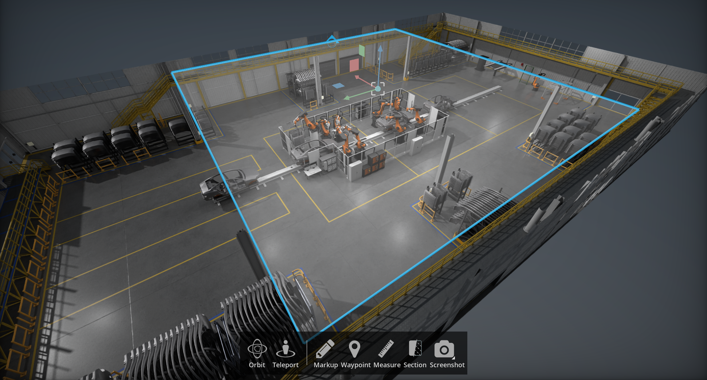

# Section Tool

The Section tool is a simple utility that allows you to create a sectional view of your scene. Additionally, you can manipulate the section plane by dragging the translate widget and changing the cutting direction.

> **Note:** The section tool is not a live-collaboration tool, it only applies to the local user.

## Interface

| Ref # | Option | Description |
|-------|--------|-------------|
| 1 | Select Tool | Section tool is found under tools menu and can be docked in the UI |
| 2 | Always Display Section | Always Display Section even if the section tool is closed |
| 3 | Display Section Manipulator | Toggles visibility of the section plane and manipulation widget |
| 4 | Align Section To... | Snaps section to X, Y or Z |
| 5 | Set Rotation | Set Rotation is applied to the local axis of the cutting plane |
| 6 | Cut Direction | Flips the Direction of the Section Cut |
