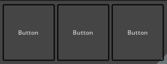
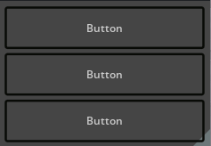
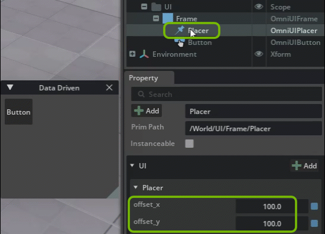
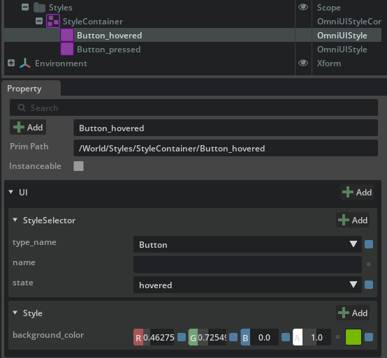
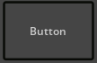
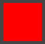
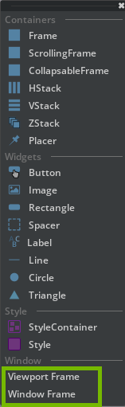
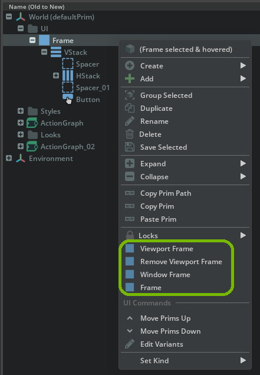
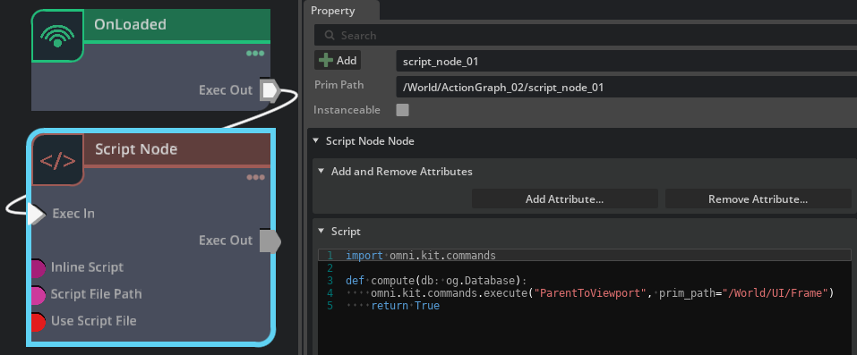
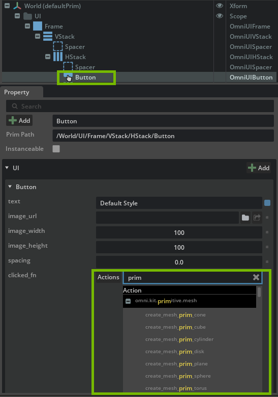

# No Code UI

The No Code UI Extension Bundle enables you to quickly and interactively build User Interfaces within your Stage. No Code UI is a data-driven UI system that works with OmniGraph, the visual scripting language of Omniverse, to handle UI events.


## The No Code UI Menu

To create a UI you use the UI submenu from the App's main **Create** menu.

The UI submenu can be found under `Create > No-Code-UI`. Alternatively you can also locate the menu under the Viewport in the `right click > create` menu, or the right click menu in the Stage.


## Example UI

Here is an example of a No Code UI. At the very top level we have a Frame. This is an invisible UI element that contains all of our UI elements. Think of it as your canvas. We create a 3x3 grid by combining two UI layout elements: A VStack and HStack. The stacks contain various UI elements such as buttons, labels and images.


## Elements

### Containers

A Container is a tool for placement and arrangement of UI elements. It can contain Widgets, such as buttons, and or other nested containers. Below is a list of all the container types available in No Code UI.

#### Frames

The base element needed as the fundamental container for all UI elements. Even if adding Scrolling or Collapsible Frames, a Frame must be the Root Element of any UI. Frames can also be nested for a more complex or robust UI.

There are two kinds of root Frames: one is a standard Window or it can be the entire Viewport.

#### ScrollingFrame

A Frame container with optional vertical and horizontal Scroll Bars. Again, a ScrollingFrame must be a descendant of a Frame.


#### Collapsible Frame

A Frame container allowing a tab-like collapse feature.


#### HStack

An *HStack* organizes nested Widgets horizontally, into columns. Stacks can be nested to create more complex layouts.



#### VStack

A *VStack* organizes nested Widgets vertically, into rows. Stacks can be nested to create more complex layouts.



#### ZStack

A *ZStack* organizes nested Widgets according to from back to front in the rendered Windows and Frames.


#### Placers

The *Placer* places a single Widget in a particular position based on the offsets specified in the properties.



### Style

#### StyleContainer

Style Containers are used to hold a set of Styles to be applied to a given UI. The Styles within a StyleContainer are applied to every UI element within it. Similar to an html cascading style sheet, these containers make quick work of setting and keeping styles consistent throughout your UI. Easily set font sizes, colors, backgrounds and other visual aspects once and re-used them from button to button or menu to menu.

#### Style

A Style defines a set of visual properties for a given UI element. For example, a Style can set the background color, margin width and alignment of a Button Widget.

#### Example StyleContainer with Styles

Here is an example of a Style within a StyleContainer. The selected Style is used to modify the background color to our favorite shade of green when hovering over a Button.



### Widgets

#### Button

The Button widget provides a command button. The command button, is perhaps the most commonly used widget in any graphical user interface. Click a button to execute a command. It is rectangular and typically displays a text label describing its action.



#### Image

The Image widget displays an image. The source of the image is specified as a URL using the source property. By default, specifying the width and height of the item causes the image to be scaled to that size. This behavior can be changed by setting the fill_mode property, allowing the image to be stretched or scaled instead. The property alignment controls where to align the scaled image.


#### Spacer

The Spacer class provides blank space. Normally, it's used to place other widgets correctly in a layout.

Here is an example of a Spacer between two Buttons.


#### Label

The Label widget provides a text to display. Label is used for displaying text. No additional to Widget user interaction functionality is provided.

Here is an example of a Label between two Buttons.


#### Line

This widget will create a colored 2 dimensional Line.


#### Rectangle

This widget will create a colored geometric Rectangle.



#### Circle

This widget will create a colored geometric Circle.


#### Triangle

This widget will create a colored geometric Triangle.


### Windows

The bottom of the UI submenu has two "shortcut" options for creating a Frame and instantiating its visibility.



#### Viewport Frame

This option creates a Frame and immediately sets it as a Viewport Frame.

#### Window Frame

This option creates a Frame and immediately sets it as a Window Frame.


## Usage

### Build a Basic No-Code UI

When constructing a UI, the first thing you need to do is create is a Frame to hold the contents of the UI. A Frame can displayed in the Viewport or in a Window. In this example we will create a simple UI to be displayed in the Viewport.

<div style="width: 100%;display: inline-block;position: relative;">
    <div id="dummy" style="margin-top: 56%;">
    </div>
    <div align="center">
    <div id="kaltura_player_1" style="position:absolute;top:0;left:0;left: 0;right: 0;bottom:0;border:solid thin black;"></div>
    <script type="text/javascript" src="https://cdnapisec.kaltura.com/p/2935771/embedPlaykitJs/uiconf_id/46302491"></script>
    <script type="text/javascript">
        try {
        var kalturaPlayer = KalturaPlayer.setup({
        targetId: "kaltura_player_1",
        provider:
        { partnerId: 2935771, uiConfId: 46302491 }
        });
        kalturaPlayer.loadMedia(
        {entryId: '1_9p9w4aj0'}
        );
        } catch (e)
        { console.error(e.message) }
    </script>
    </div>
</div>

#### Transcript

##### Step 1: Detach the No Code UI Menu

To make the UI construction more convenient it is recommended that you "tear off" and move to your panel to a convenient location.

1. Navigate to **Create** > **UI**
2. Select the **Top Bar** of the Flyout Panel and Drag it to Detach the menu panel.
3. The menu panel is now floating and you can place it where you want.

##### Step 2: Add Frames and Buttons

Adding a base Frame element is critical to any UI. Once a Frame is created, we can then add any containers or other widgets to it. Let's add a button.

1. In the `UI Flyout Panel`, select **Frame** to create your base Frame.
2. Make sure the Frame is selected in your `Stage`.
3. In the `UI Flyout Panel`, select **Button** to add a button widget.

##### Step 3: Make the UI Visible

Now, lets enable our Frame so we can see our UI start to take shape.

1. Select and right-click the **Frame** in your stage.
2. Select **Viewport Frame** from the menu.

The Button will take over the entirety of the viewport, not what we want, but it let's us verify the Frame is there.

##### Step 4: Organize your UI with Stacks

Adding Stacks to allow controlled placement and arrangement of our interface.

1. Select the **Frame** in your `Stage`.
2. In the `UI Flyout Panel`, select **VStack** to add a vertical stack to the Frame.

##### Step 5: Push Content into Position with Spacers

Spacers allow us to fill stacks easily with empty space. This is useful for positioning things like Buttons. In our example we will use spacers in the VStack to push our button to the bottom.

1. Select the **VStack** in your `Stage`.
2. In the `UI Flyout Panel`, select **Spacer** to add a Spacer widget.
3. Repeat above step by selecting **Spacer** to add a second Spacer.
4. Select **HStack**.
5. In the `Stage`, click and drag the **Button** under **Frame** to the **VStack**.

Notice how our button is now on the bottom of our vertical stack and occupies the lower third of the screen. The first and second VStack positions are occupied by our Spacers, the last third occupied by our HStack with a Button nested in it.

##### Step 6: Add More Buttons

Now we may want to have a row of Buttons. The HStack will allow us to add Buttons horizontally by adding them to the HStack.

1. Select the **Stack** in your `Stage`.
2. In the `UI Flyout Panel`, select **Button** to create another Button in the HStack. Note how the Buttons split the HStack Equally.
3. Select **Button** again to create another Button in the HStack. Note how the Buttons continue to split the HStack Equally, Now in thirds.

##### Step 7: Enable Child ReOrdering

There will often be times where you wish to reorder child elements in a stack. This is locked by default and reordering must be enabled.

1. Select the **Hamburger Menu** in the Top Right of the `Stage`.
2. Select **Enable Children Reorder**

##### Step 8: Reorder Children to Control Position

If we wish to adjust the position/placement of items in an HStack or VStack, we can simply drag items to the position we want them. Lets move Button row HStack we created to another position.

1. In the `Stage` select and drag the **HStack** from below the Spacers within the **VStack** to above the Spacers.
2. Notice how the Button row moves to the top 1/3 of the viewport.
3. In the `Stage`, select and drag the **HStack** from the above the Spacers in the **VStack** to between them.
4. Notice how the Button group centers vertically in the Viewport.

##### Step 9: Unblock UI Widgets

By default UI Widgets does not "block" mouse clicks from selecting Prims in the Viewport. In order to block accidental clicks, Stack Containers have the boolean property **content_clipping**. Enabling this option will make the UI "consume" mouse clicks and prevent any unwanted selection of Prims behind the UI.

1. Select the **HStack** in the `Stage`
2. Enable **Content Clipping** in the Properties Panel.
3. In the `Viewport`, add a cube or any other non UI element to your stage to test.

At this point you should have created a simple UI using most of the key elements. As some next steps you can try adding other buttons and working to arrange more complex UI layouts.


### Styling

Style Containers are used to hold a set of Styles to be applied to a given UI. The Styles within a StyleContainer are applied to every UI element within it. Similar to an html cascading style sheet, these containers make quick work of setting and keeping styles consistent throughout your UI. Easily set font sizes, colors, backgrounds and other visual aspects once and re-used them from button to button or menu to menu.

#### Create Styles for your UI

This video shows a simple example of how to style your UI.

<div style="width: 100%;display: inline-block;position: relative;">
    <div id="dummy" style="margin-top: 56%;">
    </div>
    <div align="center">
    <div id="kaltura_player_3" style="position:absolute;top:0;left:0;left: 0;right: 0;bottom:0;border:solid thin black;"></div>
    <script type="text/javascript" src="https://cdnapisec.kaltura.com/p/2935771/embedPlaykitJs/uiconf_id/46302491"></script>
    <script type="text/javascript">
        try {
        var kalturaPlayer = KalturaPlayer.setup({
        targetId: "kaltura_player_3",
        provider:
        { partnerId: 2935771, uiConfId: 46302491 }
        });
        kalturaPlayer.loadMedia(
        {entryId: '1_ah5j3ic8'}
        );
        } catch (e)
        { console.error(e.message) }
    </script>
    </div>
</div>

The video above shows how you can add styles to an existing UI using these steps:

##### Step 1: Create a style

1. Navigate to **Create** > **UI** and Create the select **StyleContainer**. This creates a StyleContainer in your `Stage`.
2. Bind the new StyleContainer to the Frame:
   1. In the `Stage`, Select your **Frame**.
   2. In the `Property` panel, find the `Style` section. Click **Add Target**.
   3. A `dialogue windows` comes up. Select the **StyleContainer** you created earlier.

> **Note:** It's helpful to apply the StyleContainer to the Frame from the start since it will immediately show the effects of the StyleContainer as it's being created.

##### Step 2: Set the style's properties

1. Navigate to **Create** > **UI** and select **Style**.
2. Select the `Style` in the `Stage`.
3. In the `Property` window of the style, navigate down to the `UI` > `StyleSelector` section.
4. Set the **type_name** to "Button.Label".
5. In the `Style` section, press the **+Add** button and choose "color".
6. Set the **color** to green.
7. In the `Stage`, rename the style to "Style_ButtonLabelColor".
8. Parent the **Style** into the **StyleContainer** if its not already done.

##### Step 3: Add another style

1. Add another Style and name it "Style_ButtonFontSize". This will control the font size of the Button Label.
2. In the `Property` window, navigate to `UI` > `Style`. and press the **+Add** button.
3. Choose **font_size**.
4. Set the **font_size** property to a value around 30.

#### Set styling for UI states

Styles can react to the state of a Widget, such as when a Button is pressed or is Hovered over.

<div style="width: 100%;display: inline-block;position: relative;">
    <div id="dummy" style="margin-top: 56%;">
    </div>
    <div align="center">
    <div id="kaltura_player_5" style="position:absolute;top:0;left:0;left: 0;right: 0;bottom:0;border:solid thin black;"></div>
    <script type="text/javascript" src="https://cdnapisec.kaltura.com/p/2935771/embedPlaykitJs/uiconf_id/46302491"></script>
    <script type="text/javascript">
        try {
        var kalturaPlayer = KalturaPlayer.setup({
        targetId: "kaltura_player_5",
        provider:
        { partnerId: 2935771, uiConfId: 46302491 }
        });
        kalturaPlayer.loadMedia(
        {entryId: '1_p88lpbzf'}
        );
        } catch (e)
        { console.error(e.message) }
    </script>
    </div>
</div>

This video above shows how to set a Button's "hovered" and "pressed" states, using these steps:

##### Step 1: Create a style and its state properties

1. Navigate to **Create** > **UI** and select **StyleContainer**. This creates a StyleContainer in your `Stage`.
2. Click on **Style** to add a style to the `Stage`.
3. In your `Stage`, drag the **Style** to the **StyleContainer**.
4. Make sure the **Style** in the `Stage` is selected.
5. In the `Property Panel` Change **type_name** to "Button".
6. Change **state** to "hovered".
7. In the `StyleSelector` area, click on **Add** and choose "color".
8. Set the **color** to green.

##### Step 2: Create another style

1. Create another style and parent it to the **StyleContainer**.
2. Set style's **type_name** to "Button".
3. Set the style's **state** to "pressed".
4. Set the style's **color** to blue.

#### Using Multiple StyleContainers

Multiple StyleContainers can be created and swapped out for a given UI. In this video, the StyleContainer created in the previous example is duplicated and then swapped in to replace the existing StyleContainer.

<div style="width: 100%;display: inline-block;position: relative;">
    <div id="dummy" style="margin-top: 56%;">
    </div>
    <div align="center">
    <div id="kaltura_player_4" style="position:absolute;top:0;left:0;left: 0;right: 0;bottom:0;border:solid thin black;"></div>
    <script type="text/javascript" src="https://cdnapisec.kaltura.com/p/2935771/embedPlaykitJs/uiconf_id/46302491"></script>
    <script type="text/javascript">
        try {
        var kalturaPlayer = KalturaPlayer.setup({
        targetId: "kaltura_player_4",
        provider:
        { partnerId: 2935771, uiConfId: 46302491 }
        });
        kalturaPlayer.loadMedia(
        {entryId: '1_2pnf4y5m'}
        );
        } catch (e)
        { console.error(e.message) }
    </script>
    </div>
</div>

In the video above, we swap the StyleContainers using the following steps:

##### Step 1: Duplicate the StyleContainer

1. In your `Stage` select the **StyleContainer** and duplicate it by pressing **CTRL + D**
2. Add another style to the StyleContainer.
3. In the style's `Property` window, navigate down to `UI` > `Style` and click the **+Add** button.
4. This time, select "Button" instead of "Button.Label".
5. Click the **+Add** button and choose "background_color".
6. Set the **color** to white.
7. Change the existing Style "Style_ButtonLabelColor" to green.

##### Step 2: Swap out the StyleContainer

1. In the `Stage`, select the **Frame**.
2. In the Frame's `Property window`, navigate to `UI` > `Style` and remove the style binding by pressing the red **x** button (from above example).
3. Bind the new StyleContainer by clicking **Add target** and choosing the a different StyleContainer.

#### Switching StyleContainers

This video shows how to use Button events to switch the StyleContainer of a Frame using ActionGraph. We start with two Buttons and two StyleContainers and use Custom Events to trigger ActionGraph to bind the relationship of the chosen StyleContainer to the Frame.

<div style="width: 100%;display: inline-block;position: relative;">
    <div id="dummy" style="margin-top: 56%;">
    </div>
    <div align="center">
    <div id="kaltura_player_6" style="position:absolute;top:0;left:0;left: 0;right: 0;bottom:0;border:solid thin black;"></div>
    <script type="text/javascript" src="https://cdnapisec.kaltura.com/p/2935771/embedPlaykitJs/uiconf_id/46302491"></script>
    <script type="text/javascript">
        try {
        var kalturaPlayer = KalturaPlayer.setup({
        targetId: "kaltura_player_6",
        provider:
        { partnerId: 2935771, uiConfId: 46302491 }
        });
        kalturaPlayer.loadMedia(
        {entryId: '1_u9w1tgn8'}
        );
        } catch (e)
        { console.error(e.message) }
    </script>
    </div>
</div>

The video above shows how to use custom events with buttons using the following steps:

1. Two Custom Events are created in ActionGraph: "SET_STYLE_1" and "SET_STYLE_2"
2. The events are assigned to the `clicked_fn` event of the Buttons. One event per Button corresponding to the StyleContainer we want to switch to.
3. For the Custom Events an ActionGraph node "Add Prim Relationship" is used with the "omni:ui:Style:binding" relationship with the Frame and the appropriate StyleContainer as the target.


### UI Visibility

UI by default is disabled from view. If you wish to enable visibility, you have 2 options.

#### Show the UI Manually

To display the UI in the Viewport, or in a Window, right click on the UI's Frame and select either "Viewport Frame" or "Window Frame".



This will then instantiate your UI in either the Viewport or in a Window.

> **Note:** This action needs to be done each time the scene is loaded.

#### Showing The UI Automatically

When the UI needs to be shown when the Stage is first loaded, an ActionGraph can be used to automatically populate your UI. In this example below you can see how an "OnLoaded" event is used to execute an ActionGraph Script Node that instantiates the menu.

```python
import omni.kit.commands

def compute(db: og.Database):
   omni.kit.commands.execute("ParentToViewport", prim_path="/World/UI/Frame")
   return True
```



The following script can be used in a similar way for removing the current UI from the Viewport when it is no longer needed. This can be from any given ActionGraph event or logic, but typically from an "On Closing" event.

```python
import omni.kit.commands

def compute(db: og.Database):
   omni.kit.commands.execute("RemoveViewportPrim")
   return True
```


### Event Handling

The Button Widget provides a mechanism to issue Kit commands or trigger events in response to mouse clicks. These events can be used with ActionGraph. Alternatively, events can be handled in Python with a Custom Application Event.

#### Actions

Kit Commands (Actions) can be issued from buttons to execute a variety of tasks.

The **Action** option for the "clicked_fn" has an auto-complete dropdown of commands.




#### ActionGraph Events

An ActionGraph event can be used to respond to a button's mouse clicks. In this example an ActionGraph node "Rotate to Orientation" is used to rotate a cone in the scene. A Custom Event is created in ActionGraph to trigger the rotation node. Once the event has been defined it can then be set in the Button's "clicked_fn" property.

<div style="width: 100%;display: inline-block;position: relative;">
    <div id="dummy" style="margin-top: 56%;">
    </div>
    <div align="center">
    <div id="kaltura_player_2" style="position:absolute;top:0;left:0;left: 0;right: 0;bottom:0;border:solid thin black;"></div>
    <script type="text/javascript" src="https://cdnapisec.kaltura.com/p/2935771/embedPlaykitJs/uiconf_id/46302491"></script>
    <script type="text/javascript">
        try {
        var kalturaPlayer = KalturaPlayer.setup({
        targetId: "kaltura_player_2",
        provider:
        { partnerId: 2935771, uiConfId: 46302491 }
        });
        kalturaPlayer.loadMedia(
        {entryId: '1_ppshzzk6'}
        );
        } catch (e)
        { console.error(e.message) }
    </script>
    </div>
</div>

> **Note:** The "Only Simulate On Play" checkbox is deliberately unchecked in the video since when this is enabled the event only triggers when the simulation is playing.

#### Python Events

Custom Application Events allow your UI to trigger python script(s). After defining an ActionGraph Custom Event as described above, you can use it in python like this:

```python
import carb.events
import omni.kit.app

# event "MY_CUSTOM_EVENT" defined in ActionGraph
MY_CUSTOM_EVENT = carb.events.type_from_string("omni.graph.action.MY_CUSTOM_EVENT")

def on_event(e):
   print("MY_CUSTOM_EVENT triggered with payload: ", e.payload)

bus = omni.kit.app.get_app().get_message_bus_event_stream()
event_sub = bus.create_subscription_to_pop_by_type(MY_CUSTOM_EVENT, on_event)
```

<div style="width: 100%;display: inline-block;position: relative;">
    <div id="dummy" style="margin-top: 56%;">
    </div>
    <div align="center">
    <div id="kaltura_player_5" style="position:absolute;top:0;left:0;left: 0;right: 0;bottom:0;border:solid thin black;"></div>
    <script type="text/javascript" src="https://cdnapisec.kaltura.com/p/2935771/embedPlaykitJs/uiconf_id/46302491"></script>
    <script type="text/javascript">
        try {
        var kalturaPlayer = KalturaPlayer.setup({
        targetId: "kaltura_player_5",
        provider:
        { partnerId: 2935771, uiConfId: 46302491 }
        });
        kalturaPlayer.loadMedia(
        {entryId: '1_jnfb8bha'}
        );
        } catch (e)
        { console.error(e.message) }
    </script>
    </div>
</div>
