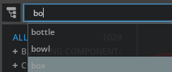
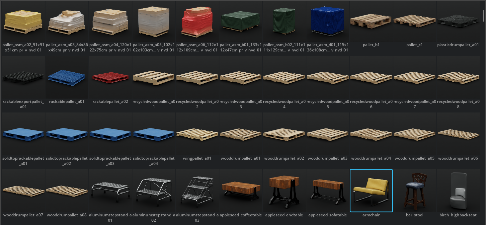
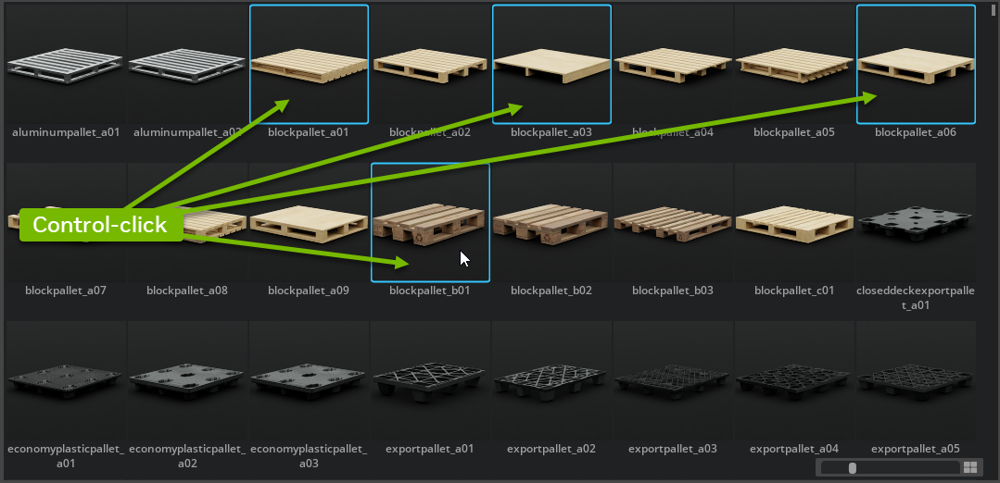
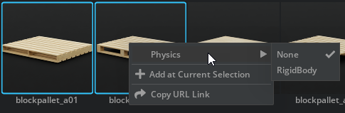
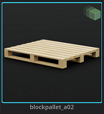
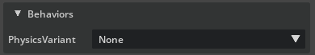
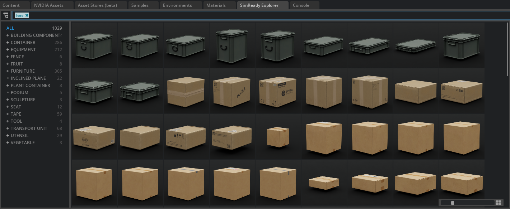

# SimReady Explorer

The SimReady Explorer is an Extension that provides a 3D content browser that allows you to search, display, inspect, and configure SimReady assets before adding them to an active Stage. It also comes with more than 1,000 SimReady assets that can be immediately added to your scenes and are prepared for simulation and synthetic data generation.

    

    

    

    

    
    
    

## User Manual

Use the SimReady Explorer Extension to discover, configure and utilize SimReady assets in your compositions. SimReady assets come pre-configured with semantic labeling (for synthetic data generation) and rigidbody physics for physical simulations and can be dragged and dropped into your scenes quickly.

| #  | UI Name                          | Description                                                                                                        |
|----|----------------------------------|--------------------------------------------------------------------------------------------------------------------|
| 1  | Search Bar                       | Searches for SimReady content within the browser                                                                   |
| 2  | Category Panel                   | Provides a hierarchical view of all of the available content that can be used to help discover SimReady content    |
| 3  | Content Display Window           | Visual browser view that displays thumbnails for all search results                                                |
| 4  | Asset Details Panel              | Shows details for a selected SimReady asset and allows for configuration of that asset prior to inclusion in an active Stage |
| 5  | Show/Hide Asset Details Panel    | Let's you show/hide the Asset Details Panel                                                                        |

## Search Bar

You can use the *Search Bar* to enter keyword search parameters to find SimReady 3D content. All of the assets within the *SimReady Explorer browser* are searched for tags and names. When you begin to type in a search term, the browser will attempt to auto-complete using existing tags and will display those options to you. These options can be selected to complete the search.

*Search auto-complete*

The search will also return partial matches. Tags are created from the semantic labels associated with the asset.

## Category Panel

The *Category Tree* is built using the hierarchy labels from SimReady content. Those structures mirror their Wikidata subclasses. By changing that attribute, you can "move" your asset around in the *Category Tree* view without having to relocate it to a new folder or location. The search is done through tag combinations, and assets can often be found in multiple sub-categories. Although you're free to change the hierarchy structures as you see fit, we strongly recommend for you to align on one of the branches derived from the "QCODE" subclass structure. See [Wikidata](https://www.wikidata.org/) for more information on "subclass".

## Content Display Window

The *Content Display* window is where your search results will show up and where you can click on an asset to view its details in the *Asset Details* panel on the right side of the SimReady Explorer tab. From here, you can simply drag and drop a SimReady asset into your Stage or the *Stage panel*.

There are two methods you can use to select multiple SimReady assets within the SimReady Explorer:

- **Shift-click**: Holding down the Shift key while clicking on two non-sequential assets within the *Content Display* window will select **all** of the SimReady assets that sit between them and they will all highlight with a blue outline. This is a convenient way of selecting an entire contiguous block of assets.

- **Control-click**: Holding down the Control key while clicking within the *Content Display* window will select each asset in the order it is chosen, but will not select assets that lie between them. This is a handy way to select specific assets that you'd like to configure and drag and drop within your stage.

> **Note:** When you engage with a multi-selection in the Content Display window, the Asset Details panel will **not** be available for direct configuration of those assets. You must use the right-click behavior described below.

The *Content Display* panel also includes a **right-click** menu that provides you with access to the SimReady behavior configuration options. This right-click option is available on both single SimReady assets as well as when multiple assets are selected using the Shift or Control click methods described above.

When you have selected a single SimReady asset, the right-click menu will display the following:

When you have selected multiple SimReady assets, the right-click menu will display the following:

In both menus, the **Physics menu** can be configured directly for one or multiple SimReady assets. By default, the Physics variant is set to "RigidBody" within the *SimReady Explorer* window, but you can select and change that with a single-click. When physics is activated within the SimReady Explorer for any SimReady asset, its thumbnail is updated to indicate that it will be added to the scene with physics enabled.

> **Note:** This is *not* a live link between the asset and the SimReady Explorer. Once a SimReady asset has been dragged into the stage, you should control or modify its behaviors and variants using the traditional Properties panel. Trying to update an asset that is already in your active Stage via the Content Display Window will not work. The thumbnail only indicates whether another instance of the same SimReady asset will have its physics on by default when you drag and drop it into the scene.

## Asset Details Panel

The *Asset Details* panel provides you with direct access to attributes associated with a SimReady asset in a resizeable window. Currently displayed information includes behaviors, asset properties and tags, all of which are derived directly from the SimReady asset itself. As such, this panel lets you better understand what your SimReady asset is (its dimensions, and classification) as well as lets you pre-configure it with behaviors and variants prior to dragging it into your active Stage.

### Behaviors

All SimReady assets come with behaviors like rigid body physics. We added the ability to configure an asset's behaviors from the browser before you drag or import it into your scene, streamlining the import process.

*SimReady Asset with no behaviour assigned to it.*

*SimReady Asset with the Rigidbody behavior assigned to it.*

### Search Shortcuts

All SimReady assets ship with semantic labels and semantic hierarchies based on [Wikidata](https://www.wikidata.org/wiki/Property:P31). Here we display them and provide search shortcuts to look for similar subclass groups. By clicking on any of the text buttons within the *Asset Details* panel, your search query will automatically update and show you SimReady assets that match the new search term. This lets you quickly go from keyword search to tag search.

For example a keyword search in the SimReady Explorer for "box" will provide you with numerous options.

Selecting an asset and examining its details, hierarchy and tags will let you quickly filter for just cardboard boxes by clicking on the hierarchy.

The *Search Bar* will also update to reflect the tag search and the *Content Display* Window will also refilter to show only those items in your refined query.

## SimReady Explorer API

You can use the SimReady Explorer API to search for assets, configure and them to the current stage. For more information see the [SimReady Explorer API](https://docs.omniverse.nvidia.com/kit/docs/omni.simready.explorer/latest/actions_api.html) documentation.
