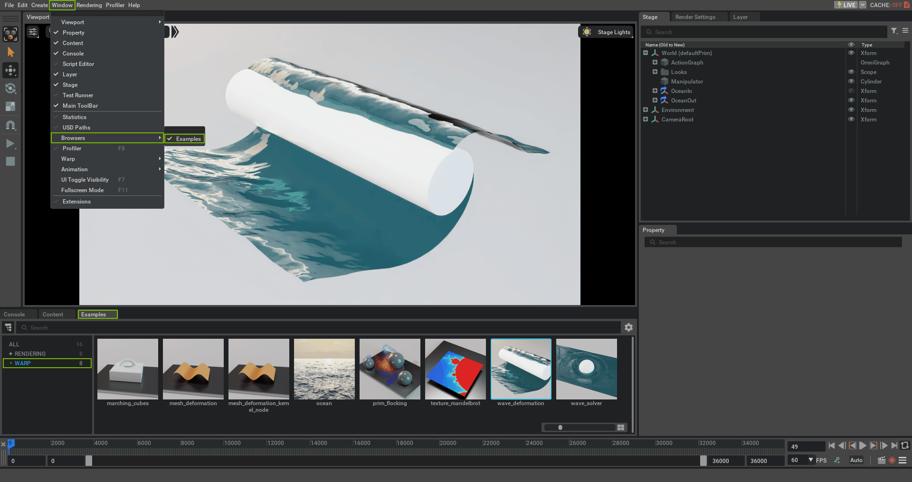

# Warp

## Overview


NVIDIA Warp is a Python framework for writing high-performance simulation and graphics code in Omniverse. Warp provides an easy way for Python coders to write kernel-based programs and benefit from GPU acceleration in Omniverse and OmniGraph.

NVIDIA's Omniverse developers are using Warp to help create new GPU-accelerated 3D simulation workflows and dynamic content today. Some of the key benefits include simulation performance on-par with native code and improved developer productivity thanks to fast iteration times.

In Warp, kernels are defined in Python syntax and JIT compiled to C++/CUDA at runtime. Users can hot-reload kernels directly from within Python and leverage rich high-level data structures and algorithms to build real-time simulations.

The `omni.warp.core` extension installs Warp into the Omniverse Application's Python environment, which allows users to import the module in their scripts and nodes.
Once enabled, users should be able to open the Script Editor window and execute the following code successfully:

```python
import warp as wp

print(wp.__version__)
```

The `omni.warp` extension provides a collection of OmniGraph nodes and sample scenes demonstrating uses of Warp in OmniGraph.
Enabling the `omni.warp` extension automatically enables the `omni.warp.core` extension.

After enabling `omni.warp`, the samples can be found in the Examples Browser.
If you do not see an Examples tab in the UI, you can show it by toggling the `Window > Browsers > Examples` menu entry:



Double-click on an example to load the scene. Press the Play button (or hit `SPACEBAR`) to run the scene.

> **Note:** A confirmation dialog will pop up when first opening a scene containing **Warp Kernel Nodes**
> as there are no limitations on what code may be executed by these nodes.
> Please do not run graphs containing Warp Kernel Nodes unless you trust the content author.


## Defining Warp Kernels

Kernels in Warp are defined using a `@wp.kernel` decorator around user Python functions.
For example, a simple function to deform a mesh according to a sine wave could be defined as follows:

```python
@wp.kernel
def compute(
    points_in: wp.array(dtype=wp.vec3),
    points_out: wp.array(dtype=wp.vec3),
    time: float,
):
    # Get thread id.
    tid = wp.tid()

    # Read input point position.
    pos = points_in[tid]

    # Sine-wave deformation.
    displacement = wp.vec3(0.0, wp.sin(time + pos[0] * 0.1) * 10.0, 0.0)

    # Write output point position.
    points_out[tid] = pos + displacement
```


## Using Warp in OmniGraph

One of the main uses for Warp in Omniverse is as a convenient and productive way to define GPU OmniGraph nodes in Python.

There are several ways to execute Warp code in OmniGraph:

* Create a custom [OmniGraph node in Python](https://docs.omniverse.nvidia.com/kit/docs/omni.graph.docs/latest/dev/CreatingPythonNodes.html#) that imports the Warp module.
* Add a Script Node to the Action Graph and import the Warp module in the script.
* Add Warp Kernel Nodes to the Action Graph (requires enabling the `omni.warp` extension).
  Each Warp Kernel Node executes a single, user-defined Warp kernel, and multiple Warp kernels can be run in parallel or in serial depending on the OmniGraph layout.

Below, we show the source for a Warp Kernel Node that deforms a set of mesh points using the previous mesh-deformation kernel and outputs the result:

```python
import warp as wp

@wp.kernel
def compute(inputs: Inputs, outputs: Outputs):
    tid = wp.tid()

    pos = inputs.points[tid]
    displacement = wp.vec3(0.0, wp.sin(inputs.time + pos[0] * 0.1) * 10.0, 0.0)
    outputs.points[tid] = pos + displacement
```

On first launch, the `compute` function will be JIT compiled to a native CUDA kernel and executed on the GPU.

We can deform a USD mesh primitive by wiring it up to the corresponding `Points` input of our Warp Kernel Node:


This scene and the rest of the Warp samples are stored in USD format and can be found along with their assets
by opening a file browser using the menu entry `Window > Warp > Sample Scenes`.
Furthermore, the source code for all the Warp nodes used in the samples can be found in the `omni.warp` extension
directory inside `omni.warp/omni/warp/nodes/_impl`. A shortcut to this location can also be found in the
`Window > Warp` menu.


## FAQ

### How to Load a Different Version of Warp?

Each Kit application ships with a specific version of the Warp extensions, and by default, only that version is available. However, you can enable newer or older versions of Warp by adding the public extension registries from other major Kit releases.

For example, to use the Warp extensions from Kit 107.X while running Kit 106.X:

1. Launch Kit and open the `Extensions` window from the `Windows > Extensions` menu.

2. Click the hamburger icon at the top of the `Extensions` window and select `Settings`.

3. In the `Extension Registries` section, click the plus icon to add a new registry.

4. For the URL, enter `https://ovextensionsprod.blob.core.windows.net/exts/kit/prod/107/shared` for Kit 107. Replace `107` with the target Kit major version.

5. Click the hamburger icon at the top of the `Extensions` window again and select `Resync Registry`.

6. Find the `omni.warp.core` extension in the list, click the hamburger icon near the extension's name to see all available versions, and note the specific version number you want to load.

7. Relaunch Kit from the command line, using the `--enable` flag to specify the version for each extension. For example: `kit --enable --enable omni.warp.core-X.Y.Z`. If `omni.warp` is also desired, a compatible version must also be enabled using `--enable omni.warp-X.Y.Z`.

See the [omni.kit.registry.nucleus's documentation](https://docs.omniverse.nvidia.com/kit/docs/omni.kit.registry.nucleus/latest/Overview.html#basic-principle) for alternative methods to set the registry.

If using IsaacLab, the `--enable` flags need to be passed using the dedicated `kit_flags`: `isaaclab.sh -p script_to_run.py --kit_args "--enable omni.warp.core-X.Y.Z"`.


## Further Reading

Please see the following external references for more background and the full documentation of the Warp SDK:

* [Warp GitHub Repository](https://github.com/NVIDIA/warp/)
* [Warp Documentation](https://nvidia.github.io/warp)
* [Product Page](https://developer.nvidia.com/warp-python)
* [GTC 2024 Presentation](https://www.nvidia.com/en-us/on-demand/session/gtc24-s63345/)
* [GTC 2022 Presentation](https://www.nvidia.com/en-us/on-demand/session/gtcspring22-s41599)
* [GTC 2021 Presentation](https://www.nvidia.com/en-us/on-demand/session/gtcspring21-s31838)
* [GTC March 2022 Overview Presentation](https://www.nvidia.com/en-us/on-demand/session/gtcspring22-s41599/)
* [SIGGRAPH 2024 Course Slides](https://dl.acm.org/doi/10.1145/3664475.3664543)
* [SIGGRAPH 2022 Multi-GPU Presentation](https://www.nvidia.com/en-us/on-demand/session/siggraph2022-sigg22-s-04/)
* [SIGGRAPH Asia 2021 Differentiable Simulation Course](https://dl.acm.org/doi/abs/10.1145/3476117.3483433)
